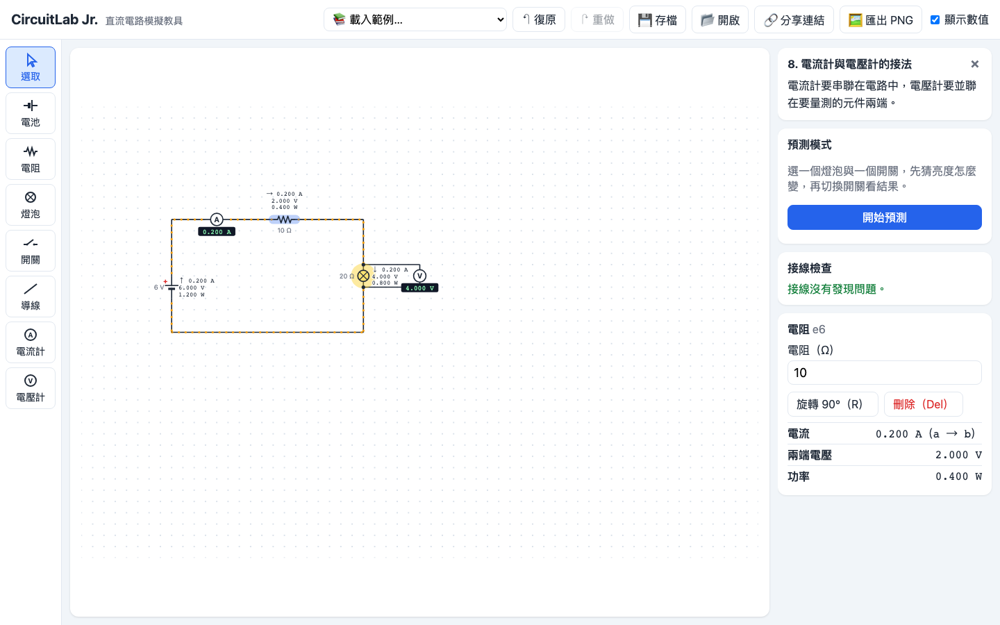
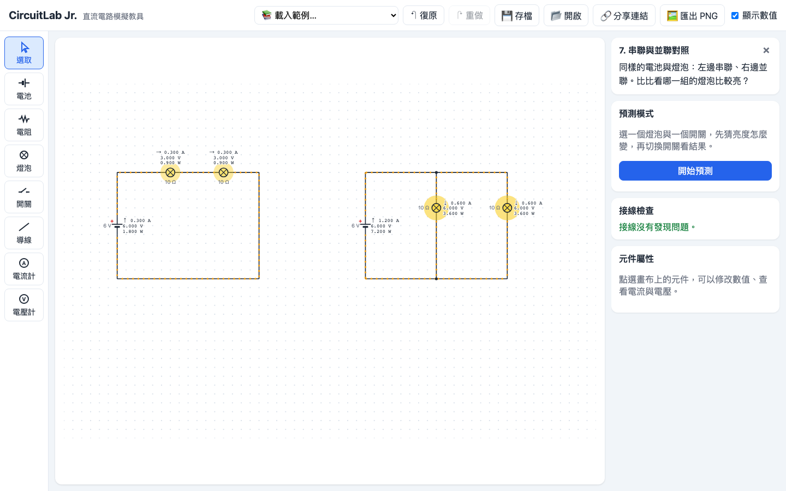
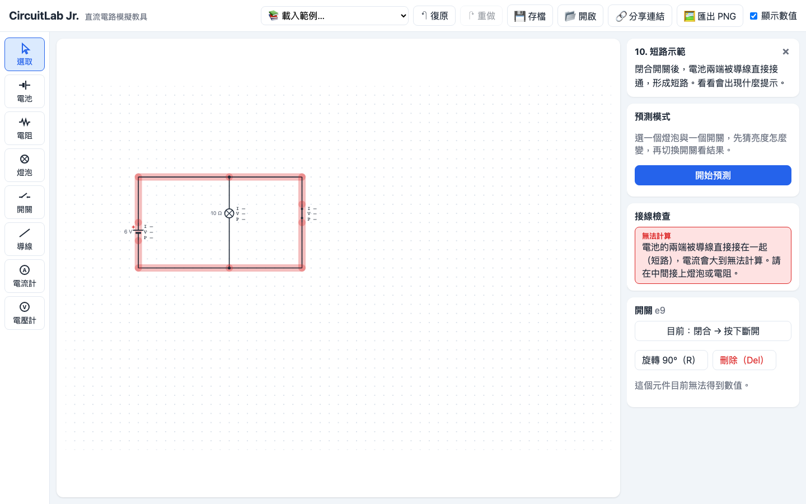
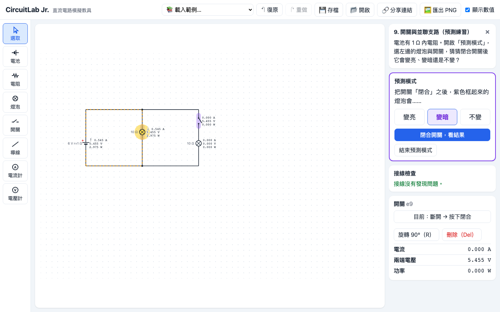
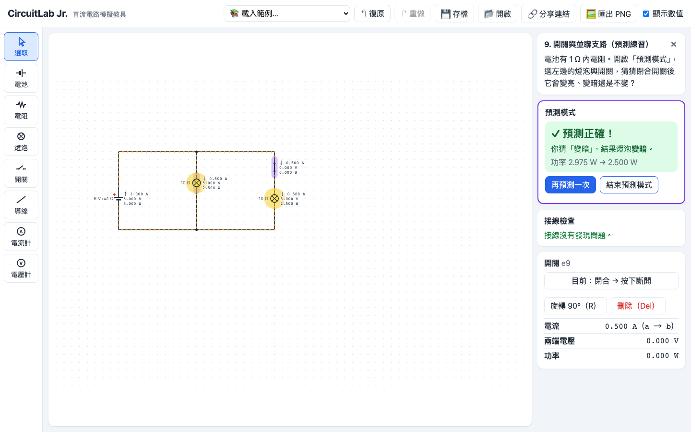

# CircuitLab Jr. 直流電路模擬教具

給國中理化課使用的網頁電路模擬器：在格點畫布上接電路，即時看到每個元件的電流、電壓與功率。可以投影上課，也可以讓學生自己動手。

- **線上 Demo**：<https://hn83320589.github.io/CircuitLab/>
- 純前端：React 19 + TypeScript（strict）+ Vite，不需要後端
- 電路求解（MNA 與高斯消去法）全部自行實作，沒有使用電路模擬或線性代數套件



## 啟動方式

需要 Node.js 22.12 以上（CI 使用 Node 24）。

```bash
npm install
npm run dev        # 開發伺服器 http://localhost:5173
```

| 指令                | 用途                                                                            |
| ------------------- | ------------------------------------------------------------------------------- |
| `npm test`          | Vitest 單元測試與性質測試（123 個）                                             |
| `npm run lint`      | ESLint                                                                          |
| `npm run typecheck` | TypeScript 型別檢查                                                             |
| `npm run build`     | 建置 production 版本到 `dist/`                                                  |
| `npm run e2e`       | Playwright 端對端測試與效能量測（第一次需先 `npx playwright install chromium`） |

## 操作說明

| 操作         | 方式                                                       |
| ------------ | ---------------------------------------------------------- |
| 放置元件     | 左側選擇元件（或按數字鍵 1–8）→ 點畫布                     |
| 畫導線       | 選「導線」→ 從一個格點按住拖到另一個格點                   |
| 移動         | 「選取」工具下拖曳元件；選取導線後可拖曳兩端的圓點改變形狀 |
| 旋轉／刪除   | 選取後按 `R`／`Delete`，或用右側面板的按鈕                 |
| 切換開關     | 直接點一下開關                                             |
| 修改數值     | 選取元件，在右側「元件屬性」輸入後按 Enter                 |
| 復原／重做   | `Ctrl+Z`／`Ctrl+Shift+Z`（或 `Ctrl+Y`），最多 100 步       |
| 回到選取工具 | `Esc`                                                      |

- **連接規則**：兩個端點落在同一格點才算相連；導線經過格點的中間不會相連。三個以上端點交會的格點畫實心黑點，沒接上的端點畫橘色空心圈。
- **結果顯示**：元件旁顯示電流（箭頭為電流方向）、兩端電壓與功率。可以用右上角的「顯示數值」整體切換。電池顯示的是輸出功率。導線上的流動點表示電流方向，流得越快代表電流越大。燈泡越亮光暈越大。
- **接線檢查**：有問題的元件會標紅（無法計算）或標橘（注意），右側面板會用一句話說明原因。點一下說明就會選取那個元件。
- **預測模式**：按「開始預測」→ 點選要觀察的燈泡 → 點選要切換的開關 → 學生選擇「變亮／變暗／不變」→ 按按鈕或直接點開關 → 顯示預測是否正確，以及切換前後的功率。
- **存檔與分享**：「存檔」下載 JSON 檔，「開啟」讀回。「分享連結」會把電路壓縮後放在網址中並複製到剪貼簿，開啟連結就能重現電路。「匯出 PNG」下載畫布圖片。
- **範例**：右上角「載入範例」內建 10 個電路，載入後右側會顯示教學說明。

| 電流動畫（串聯與並聯對照）        | 錯誤提示（短路）                   |
| --------------------------------- | ---------------------------------- |
|  |  |

| 預測模式：猜測                                    | 預測模式：結果                                     |
| ------------------------------------------------- | -------------------------------------------------- |
|  |  |

### 內建範例

1. 串聯電路（12 V、4 Ω + 8 Ω）
2. 並聯電路（6 V、3 Ω ∥ 6 Ω）
3. 串並聯混合
4. 惠斯登電橋（平衡）
5. 惠斯登電橋（不平衡）
6. 電池內電阻與端電壓（9 V、r = 1 Ω、8 Ω 負載）
7. 串聯與並聯對照（同一張畫布兩組電路）
8. 電流計與電壓計的接法
9. 開關與並聯支路（預測練習）
10. 短路示範

## 求解方法

完整的設計文件在 [docs/architecture.md](docs/architecture.md)。想從程式設計與系統分析的角度學習這個專案，請看[教學文件](docs/tutorial/README.md)（需求分析、架構、演算法、測試、實戰教訓與練習題）。程式碼在 `src/solver/`，不依賴 React 和 DOM。

### 1. 節點如何建立

```
Circuit ─① 格點節點 → ② 0 Ω 元件縮合成超節點 → ③ 拓樸檢查
        → ④ 依連通分量各自建 MNA 求解 → ⑤ 分配 0 Ω 元件電流 → ⑥ 組合結果
```

1. 每個被元件端點用到的格點是一個「點」。端點座標相同就是同一點（`netlist.ts`）。
2. **導線、電流計、閉合的開關**的電阻都是 0，用 union-find 把它們兩端的點合併成一個「超節點」，不放進矩陣。
3. 以電阻、燈泡、電池這些「導電元件」把超節點分成**連通分量**。每個分量各自選一個接地點，各自建方程組求解（`solve.ts`）。

依連通分量分開求解有三個好處：同一張畫布上的兩組電路，結果和分開求解**完全相同**（建出來的子矩陣一模一樣）；其中一組接錯，另一組照常顯示；矩陣也變小。

### 2. 方程式如何建立（Modified Nodal Analysis）

每個分量的未知數是「接地點以外的超節點電位」加上「每個電池的電流」（`mna.ts`）：

- **電阻、燈泡**（電導 G = 1/R，接在 i、j 之間）：
  `A[i][i] += G, A[j][j] += G, A[i][j] −= G, A[j][i] −= G`
- **電池**（負極 p、正極 q、電動勢 E、內電阻 r，電流未知數 I 在第 k 列）：
  - KCL：`A[p][k] += 1, A[q][k] −= 1`
  - 支路方程式 `V(q) − V(p) + r·I = E`：`A[k][q] = 1, A[k][p] = −1, A[k][k] = r, b[k] = E`

  r = 0 時就是理想電壓源，同一條公式不需要特例。

接著用**含部分樞軸的高斯消去法**求解（`linalg.ts`）。每一步都選該欄絕對值最大的列當樞軸。樞軸小於「矩陣最大元素 × 1e-13」時回報奇異，不會硬除而產生 NaN。

### 3. 理想元件如何處理

| 元件                         | 模型     | 處理方式                                                                                                                                                                             |
| ---------------------------- | -------- | ------------------------------------------------------------------------------------------------------------------------------------------------------------------------------------ |
| 導線、閉合開關、電流計       | 0 Ω      | 縮合進超節點。求解後在超節點內部分配電流：假設每條 0 Ω 邊的電阻相同，解一個 Laplacian 方程組（最小能量解）。並聯的導線會平分電流，每個格點都滿足 KCL。電流計的讀數就是它分到的電流。 |
| 電壓計、斷開的開關           | ∞ Ω      | 不寫入矩陣。讀數為兩端電位差，所以接上電壓計不會影響原電路。                                                                                                                         |
| 電池內電阻                   | 串聯電阻 | 放在支路方程式的 `r·I` 項；r 可以是 0。                                                                                                                                              |
| 電動勢相同、r = 0 的電池並聯 | —        | 合併成一條電壓源支路求解，再把電流平分給各電池。                                                                                                                                     |

為什麼不把 0 Ω 元件當成「0 V 電壓源」？那樣的話，學生多畫一條平行導線就會形成電壓源迴路，矩陣會變成奇異。

### 4. 如何偵測錯誤接法

會讓矩陣奇異的接法，都在**解矩陣之前**從拓樸偵測出來（`topology.ts`），所以能精確指出是哪個元件、什麼原因。高斯消去法的奇異判定只是最後一道防線。

| 情況                          | 偵測方式                                                                   | 等級     | 畫面說明                                      |
| ----------------------------- | -------------------------------------------------------------------------- | -------- | --------------------------------------------- |
| 導線直接接在 r = 0 的電池兩端 | 電池兩極落在同一個超節點                                                   | 無法計算 | 電池的兩端被導線直接接在一起（短路）…         |
| 電流計直接並聯在電池兩端      | 同上，短路路徑上有電流計                                                   | 無法計算 | 電流計的電阻是 0，直接接在電池兩端會造成短路… |
| 電動勢不同、r = 0 的電池並聯  | 理想電池在超節點圖上形成迴路，沿生成森林加總電位差 ≠ E                     | 無法計算 | 兩個電壓不同的電池直接並聯…                   |
| 理想電池接成一圈但電動勢一致  | 同上，加總 = E（電流無法決定）                                             | 無法計算 | 這幾個電池直接接成一圈…                       |
| 只接了一端的懸空元件          | 反覆移除「端點所在格點只有它自己」的元件（剝葉子），整串懸空元件都會被找出 | 注意     | 這個元件有一端沒有接上…                       |
| 電壓計串聯在電路中            | 讀數不為 0、沒有元件和它直接並聯，且它至少一端完全沒有電流（啟發式）       | 注意     | 電壓計應該「並聯」在要量測的元件兩端…         |
| 電壓計一端沒接上              | 兩端不在同一個連通分量                                                     | 注意     | 電壓計有一端沒有接到電路上…                   |
| 有內電阻的電池被短路          | 電池兩極在同一超節點，r > 0（可計算，I = E/r）                             | 注意     | 電池被短路了，電流非常大…                     |

「無法計算」只影響所在的連通分量，該分量的元件顯示「—」。所有顯示的數字都經過 `format.ts`，非有限值一律顯示「—」，這是第二道防線。

## 性質測試的設計

`src/solver/solve.property.test.ts` 使用 [fast-check](https://github.com/dubzzz/fast-check)，固定種子 `20261023`，每個性質跑 1,000 個隨機合法電路。

**電路產生器**（`src/solver/testing/randomCircuit.ts`）：

1. 隨機產生 2–10 個抽象節點，先用隨機生成樹保證連通，再加上最多 8 條額外的邊形成迴路。
2. 每條邊隨機選元件種類（電阻、燈泡、電池、導線、電流計、開關、電壓計）和數值（電阻 0.1–1000 Ω、電動勢 0.5–24 V、內電阻 0 或 0.1–10 Ω）。
3. **合法性在產生時就保證**：先把 0 Ω 元件縮合，理想電池如果在縮合後形成自環或迴路（電流無法決定），就改成有內電阻的電池。
4. 透過 `layoutNetlist` 把抽象網表放到格點上（每個節點一個匯流格點，元件用導線接過去），所以測試會走完整條管線，包括網表建立和 0 Ω 電流分配。

平均每個電路 26 個元件、最多 51 個，約 58% 有電流流動，也會自然觸發懸空、短路警告等情況。

**驗證的性質**：

| 性質                                          | 門檻            |
| --------------------------------------------- | --------------- |
| 沒有 error，所有數值都是有限值                | —               |
| 每個**格點**的流入與流出電流加總              | < 1e-9 A        |
| 電源提供的功率 Σ E·I = 元件消耗 Σ I²R + Σ I²r | 相對誤差 < 1e-6 |
| 兩個隨機電路放在同一畫布，結果與分開求解      | 完全相同        |
| 接上隨機電壓計，所有元件電流不變              | < 1e-9          |
| 同一電路求解兩次（含 JSON 複製）              | 位元級相同      |

fast-check 失敗時會自動把反例縮小，方便除錯。我也做過「故意弄壞程式碼」的檢查，確認這些性質真的能抓到錯誤。

## 效能量測結果

測試電路是 `src/perf/benchmarkCircuit.ts`：11 × 10 節點的網格，共 200 個元件（不含 2 條導線），全部在同一個連通分量，是最壞的情況。

以 Playwright 在 production build 上自動量測（`e2e/perf.spec.ts`）。量測範圍從「在電阻輸入框按下 Enter」開始，到「畫面上的數值已更新，且下一幀已繪製」為止，共 30 次：

| 項目                             | 結果    |
| -------------------------------- | ------- |
| 中位數                           | 18.1 ms |
| p95                              | 18.8 ms |
| 最大值                           | 20.0 ms |
| 求解器本身（Node，100 次中位數） | 0.21 ms |

這些時間大部分是在等瀏覽器的下一幀（60 Hz 約 16.7 ms），遠低於 100 ms 的要求。量測環境：Apple Silicon Mac、Chromium headless。CI 也會跑這個測試，p95 超過 100 ms 就會失敗；在 GitHub Actions 的 ubuntu runner 上，第一次執行的結果是中位數 22.2 ms、p95 38.1 ms。

讓它這麼快的設計：

- 依連通分量分開求解，矩陣小。
- 元件以 `React.memo` 搭配數值比較，只有結果改變的元件會重繪。
- 流動點用 CSS 動畫，每一幀都不需要執行 JavaScript。

## 測試

- **Vitest：123 個**。包含教科書電路（12 V 串聯 4 Ω + 8 Ω、6 V 接 3 Ω ∥ 6 Ω、惠斯登電橋平衡與不平衡、9 V r = 1 Ω 端電壓，誤差都遠小於 0.1%）、電錶、兩組獨立電路、5 種指定的錯誤接法與其他接法、1,000 個電路的性質測試、編輯器與 60 步 Undo/Redo、JSON 與分享連結的來回轉換、預測模式、10 個範例的數值。
- **Playwright：5 個**。包含效能量測、範例冒煙測試（頁面上沒有 NaN/Infinity）、短路提示、預測模式、在已開啟的分頁貼上分享連結。
- **測試報告**：逐項對照驗收標準的結果、實際誤差、證據截圖，見 [docs/test-report.md](docs/test-report.md)。
- **GitHub Actions CI**：lint、格式、型別、單元測試、建置、E2E。main 分支通過後自動部署到 GitHub Pages。

## 專案結構

```
src/
  model/      資料型別、元件預設值與數值範圍、旋轉與位移
  solver/     網表、拓樸檢查、MNA、高斯消去法、0 Ω 電流分配、錯誤訊息（純 TS）
  editor/     編輯動作 reducer 與 Undo/Redo 歷史
  teaching/   預測模式邏輯、範例電路
  io/         JSON 存讀與驗證、分享連結、PNG 匯出
  perf/       200 元件的基準電路
  ui/         React 元件（SVG 畫布、面板）
e2e/          Playwright 測試
docs/         設計文件與截圖
```

## 已知限制

- 只處理直流穩態和線性元件，燈泡電阻不隨溫度改變。
- 「電壓計串聯」是啟發式判定：讀數不為 0、沒有元件和它直接並聯，且至少一端沒有電流。少數特殊接法可能誤判。
- 0 Ω 元件形成迴路時（例如兩條導線並聯），電流採用平均分配（最小能量解）。理想化之後這個分配本來就無法唯一決定。
- 理想電池（r = 0）接成迴路時：電動勢相同的直接並聯可以計算；其他形狀一律提示無法計算，並建議設定內電阻。
- 電壓計與電流計顯示讀數的絕對值，沒有正負極性。
- 一般元件固定佔 2 格，畫布固定 60 × 40 格。在較小的螢幕上，元件和文字會比較小。
- 只支援桌機瀏覽器（最新版 Chrome、Edge）的滑鼠操作，不支援觸控。
