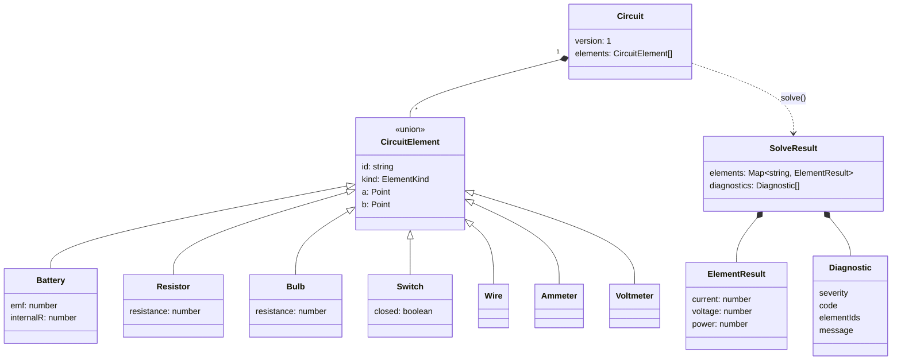
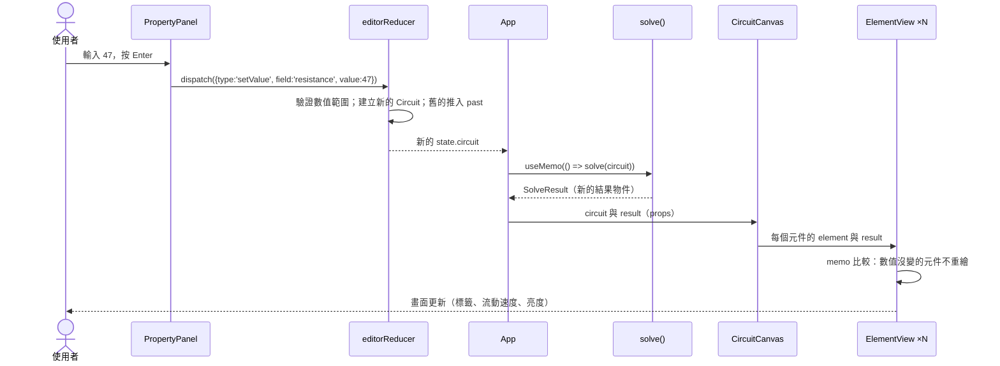
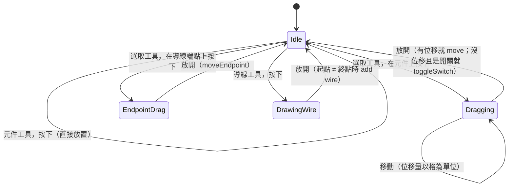
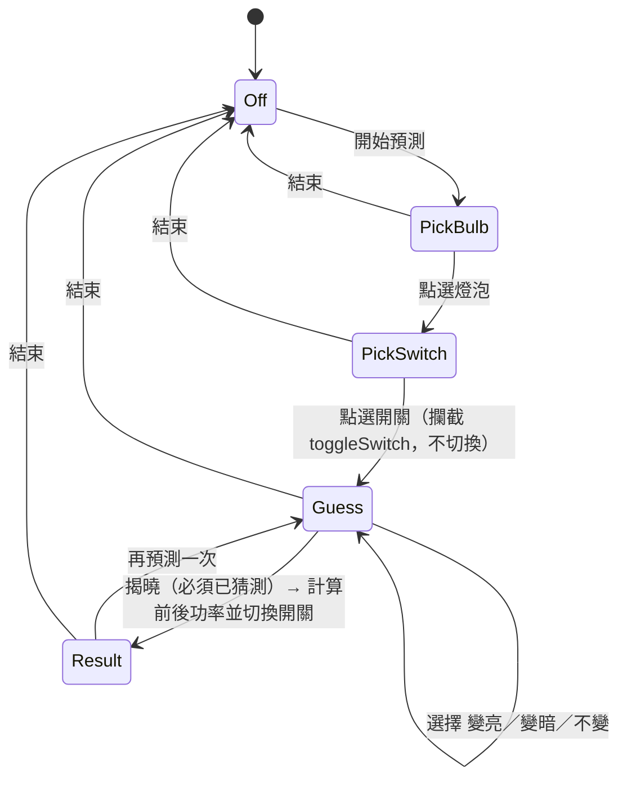
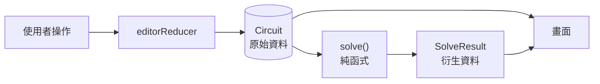

# 第 2 章　系統分析

> **本章目標**
>
> - 把物理領域的概念轉換成程式可以處理的模型
> - 用類別圖、使用案例、循序圖、狀態圖描述系統
> - 分辨「原始資料」與「衍生資料」
> - 系統化地分析所有例外情境

需求分析回答「要做什麼」；系統分析回答「這個系統由哪些東西組成、它們怎麼互動」。本章還不寫程式，但每個決定都會直接變成第 5 章的程式碼。

## 2.1 領域分析：從物理到程式

開發者不一定是領域專家。系統分析的第一步，是**把領域概念整理成詞彙表**，確認每個詞在程式中代表什麼。

| 物理概念                | 意義                        | 在程式中的對應                                           |
| ----------------------- | --------------------------- | -------------------------------------------------------- |
| 節點（node）            | 電位相同的一群連接點        | 格點（point）→ 超節點（supernode）                       |
| 支路（branch）          | 兩節點間的一個元件          | `CircuitElement`，有端點 `a`、`b`                        |
| 電位（potential）       | 節點相對於參考點的電壓      | `voltage[supernode]`，每個連通分量選一個接地點           |
| KCL（克希荷夫電流定律） | 流入節點的電流 = 流出的電流 | MNA 每個節點一條方程式；測試中的不變量                   |
| KVL（克希荷夫電壓定律） | 繞迴路一圈，電壓總和為 0    | 隱含在「每個節點只有一個電位」中；理想電池迴路的矛盾判定 |
| 歐姆定律                | V = I · R                   | 電阻支路的電導蓋章（stamp）                              |
| 電動勢 E、內電阻 r      | 電池的理想電壓與內部損耗    | 支路方程式 `V₊ − V₋ + r·I = E`                           |
| 理想電流計              | 內阻 0                      | 與導線同類：縮合進超節點                                 |
| 理想電壓計              | 內阻無限大                  | 與斷開的開關同類：不寫入矩陣                             |

> **教學提示**：注意最後兩列。物理上「電流計」和「導線」是完全不同的東西，但在**求解的角度**，它們是同一類（0 Ω）。好的分析會找出這種「表面不同、本質相同」的分類，讓程式更簡單。程式中用 `ElementRole`（`zeroOhm`、`resistive`、`source`、`open`）表達這個分類。

## 2.2 領域模型



### 關鍵建模決策

**決策 1：所有元件都只用兩個端點表示。**

這看起來理所當然，但其他選擇也很常見，例如「元件有位置、方向、長度」三個屬性。只用兩個端點的好處是：

- 求解器只關心「哪兩個點之間有什麼元件」，兩個端點就是它需要的全部資訊。
- 導線和其他元件可以用同一種結構表示。
- 旋轉、平移都只是對兩個點做座標轉換。

**決策 2：一般元件固定長度 2 格，以中點旋轉。**

為什麼是 2 而不是 3？因為**長度為偶數時，中點一定落在格點上**，以中點旋轉 90° 後，兩個端點仍在格點上。長度為 3 時，中點是 (x + 1.5, y)，旋轉後端點會落在半格的位置，無法吸附。這是一個由幾何限制推導出來的決定，不是隨便選的數字。

**決策 3：只有端點落在同一格點才算相連。**

需求原文就是這樣寫的，而且這讓規則非常簡單：「導線經過某個格點的中間」不算相連。這樣一來，網表建立只需要比對端點座標（第 6.1 節）。

**決策 4：電池的 `b` 端是正極。**

方向一定要有明確的約定，否則電流的正負號會混亂。整個系統統一採用：

- 元件的電流：從 `a` 流向 `b` 為正。
- 元件的電壓：`V(a) − V(b)`。
- 元件的功率：`電壓 × 電流`，代表「吸收的功率」。電池在供電時是負值。

這組約定稱為**被動符號慣例**（passive sign convention）。它的好處是：所有元件的功率加總恆為 0（特勒根定理），可以直接拿來當測試的不變量（第 7.4 節）。

## 2.3 使用案例

| 編號 | 使用案例     | 主要角色   | 前置條件     | 主要流程                                     |
| ---- | ------------ | ---------- | ------------ | -------------------------------------------- |
| UC1  | 建立電路     | 學生       | 無           | 選工具 → 點畫布放置 → 拖曳調整 → 畫導線連接  |
| UC2  | 修改元件數值 | 學生、老師 | 已有元件     | 點選元件 → 在屬性面板輸入 → 按 Enter         |
| UC3  | 切換開關     | 學生、老師 | 已有開關     | 點一下開關                                   |
| UC4  | 查看結果     | 所有人     | 無           | 看元件旁的標籤、流動點、燈泡亮度、電錶讀數   |
| UC5  | 了解錯誤     | 學生       | 接法有問題   | 看紅／橘標示 → 讀右側說明 → 點說明以選取元件 |
| UC6  | 預測活動     | 老師、學生 | 有燈泡與開關 | 選燈泡 → 選開關 → 猜測 → 切換開關 → 看判定   |
| UC7  | 復原與重做   | 所有人     | 有編輯紀錄   | Ctrl+Z／Ctrl+Shift+Z                         |
| UC8  | 分享電路     | 老師       | 無           | 按「分享連結」→ 貼給學生 → 學生開啟          |
| UC9  | 存檔與開檔   | 老師       | 無           | 存 JSON → 之後開啟                           |
| UC10 | 載入範例     | 老師       | 無           | 從選單選擇範例 → 讀說明                      |

### 主要流程的循序圖：修改電阻值（UC2）

這是最核心的流程，也是效能需求（N4）量測的對象。



注意兩件事：

1. reducer 只負責「改電路」，不負責求解。求解是畫面渲染時從電路**算出來**的（第 2.5 節）。
2. 每次求解都會產生新的結果物件，所以 `ElementView` 要用**數值**比較，而不是比較物件參考，否則 200 個元件每次都會全部重繪。

## 2.4 狀態分析

系統中有三個需要明確定義的狀態機。用狀態圖畫出來，可以檢查「每個狀態下，每個事件會發生什麼事」有沒有遺漏。

### 狀態機 1：畫布手勢



「沒有位移就是點擊」這條規則，讓同一個動作（按下再放開）可以同時支援「拖曳開關」和「點開關切換」，不需要另外設計切換按鈕。

### 狀態機 2：預測模式



這張圖直接對應到 `src/teaching/prediction.ts` 的 `predictionReducer`。每個箭頭都是 reducer 中的一個分支。不在圖上的轉換，例如在 `Guess` 狀態收到 `pickBulb`，reducer 會原封不動地回傳原狀態。

### 狀態機 3：歷史紀錄（Undo／Redo）

```
past: [C0, C1, C2]   present: C3   future: []

編輯     → past: [C0, C1, C2, C3]  present: C4  future: []      （清空 future）
復原     → past: [C0, C1]          present: C2  future: [C3]
重做     → past: [C0, C1, C2]      present: C3  future: []
```

這是經典的「三段式歷史」模型。分析時要回答幾個邊界問題：

| 問題                                             | 決定                                  |
| ------------------------------------------------ | ------------------------------------- |
| 沒有歷史時按復原？                               | 不動作，回傳原狀態                    |
| 復原後做新編輯？                                 | 清空 `future`（不能再重做）           |
| 歷史超過上限？                                   | 丟掉最舊的（上限 100，需求是至少 50） |
| 「選取」算不算編輯？                             | 不算，不寫入歷史                      |
| 「沒有改變任何東西」的操作（例如設成相同的值）？ | 不算，不寫入歷史                      |
| 載入範例？                                       | 算，可以復原                          |
| 開啟分享連結？                                   | 開始一段**新的**歷史（`reset`）       |

## 2.5 資料流：原始資料與衍生資料

系統中的資料可以分成兩類：

- **原始資料**（source of truth）：只能由使用者操作改變。本系統只有 `Circuit`，加上選取狀態、目前的工具等 UI 狀態。
- **衍生資料**（derived data）：可以從原始資料算出來。求解結果 `SolveResult`、錯誤標示、燈泡亮度都屬於這類。



**衍生資料不存進 state**，每次都從原始資料重新計算。這是本系統最重要的分析結論之一，因為它直接保證了兩條需求：

- **Undo 後結果相同**：只要還原 `Circuit`，再呼叫一次 `solve()`，結果自然相同，不需要另外保存或還原求解結果。
- **存檔還原後結果相同**：存檔只需要存 `Circuit`。

代價是每次編輯都要重新求解一次。分析階段先估算成本：200 個元件、MNA 矩陣約 100–150 階，高斯消去約 1 百萬次浮點運算，在 JavaScript 中只需幾毫秒，遠低於 100 ms 的預算。實測的結果是 0.21 ms（第 6.10 節）。

> **常見錯誤**：把衍生資料也存進 state，例如在 reducer 裡求解並把結果存起來。這樣 Undo 時就必須同時還原兩份資料，一旦忘記其中一份，畫面就會顯示錯的結果。「單一資料來源」是避免這類 bug 最有效的方法。

## 2.6 外部介面

| 介面     | 方向       | 格式                         | 注意事項                             |
| -------- | ---------- | ---------------------------- | ------------------------------------ |
| JSON 檔  | 輸入／輸出 | `{ app, version, elements }` | 讀入時視為**不可信**的輸入，逐欄驗證 |
| 分享連結 | 輸入／輸出 | `#c=<壓縮後的 base64url>`    | 同上；網址可能被截斷或竄改           |
| PNG      | 輸出       | 畫布截圖                     | 不含編輯用的控制點                   |
| 剪貼簿   | 輸出       | 文字                         | 瀏覽器可能拒絕權限，要有替代方案     |

「視為不可信的輸入」是這裡的關鍵分析結論。學生可能手動改 JSON 檔，網址可能在傳送過程中被截斷。如果直接相信檔案內容，一個 `"resistance": "abc"` 就會讓 NaN 進入求解器，違反需求 N1。

## 2.7 例外情境分析：理想元件的難題

這是本章最重要的一節。第 1.5 節提到，理想元件和「不能當掉」的需求互相衝突。系統分析要做的是：**列舉所有可能的錯誤接法，對每一種決定系統該怎麼反應。**

### 分析方法

先問：「什麼情況下，這個電路在**物理上**就沒有合理的答案？」

| 接法                            | 物理上會發生什麼                    | 有沒有合理答案？ | 系統的反應                         |
| ------------------------------- | ----------------------------------- | ---------------- | ---------------------------------- |
| 導線直接接在 r = 0 的電池兩端   | I = E / 0 → 無限大                  | ❌ 沒有          | **錯誤**：無法計算                 |
| 電流計直接接在 r = 0 的電池兩端 | 同上（電流計內阻 0）                | ❌ 沒有          | **錯誤**，說明要提到電流計         |
| 電動勢不同、r = 0 的電池並聯    | 同兩點要同時有兩種電位差 → KVL 矛盾 | ❌ 沒有          | **錯誤**                           |
| 電動勢相同、r = 0 的電池並聯    | 總電流確定，但各電池的分配不確定    | ⚠️ 總量有答案    | **可以計算**，平分電流（課本情境） |
| 只接了一端的元件                | 沒有通路 → 電流為 0                 | ✅ 有            | 計算，但**提醒**學生               |
| 電壓計串聯在電路中              | 電路幾乎斷開，電壓計讀到電源電壓    | ✅ 有            | 計算，但**提醒**這不是正確接法     |
| 電壓計一端沒接上                | 懸空的一端沒有確定的電位            | ❌ 讀數沒有答案  | 電壓計顯示「—」，其他元件照常      |
| r > 0 的電池被短路              | I = E / r，很大但有限               | ✅ 有            | 計算，但**警告**很危險             |

這張表把錯誤分成兩個等級：

- **error（無法計算）**：物理上沒有答案。該電路的所有元件顯示「—」。
- **warning（注意）**：物理上有答案，但接法不合理，或學生可能誤解。照常顯示結果，並附上說明。

### 錯誤的影響範圍

分析的下一個問題是：一個錯誤會影響多少東西？

需求提到老師會在同一張畫布上放兩組電路。如果其中一組接錯，另一組也跟著顯示「—」，課堂就無法進行。所以結論是：**錯誤只影響它所在的那一組電路**（連通分量）。這個結論直接決定了第 6.4 節「依連通分量分開求解」的架構。

### 錯誤訊息的設計原則

每則錯誤訊息都遵守三個原則：

1. **說發生了什麼**，用學生的語言（「電池的兩端被導線直接接在一起」），不用術語（「矩陣奇異」）。
2. **說為什麼不行**（「電流會大到無法計算」）。
3. **說怎麼修正**（「請在中間接上燈泡或電阻」）。

## 本章重點

1. 整理領域詞彙表，找出「表面不同、本質相同」的分類（電流計 ≈ 導線）。
2. 建模決策要有理由。例如元件長度取 2，是因為偶數長度才能以中點旋轉。
3. 用狀態圖檢查邊界情況；圖上的每個箭頭都應該對應到程式中的一個分支。
4. 衍生資料不存 state，從原始資料重新計算，就能「免費」保證 Undo 與存檔的正確性。
5. 例外分析的第一個問題是：「物理上有沒有合理的答案？」

## 練習

1. **（建模）** 如果要新增「可變電阻」（三個端點），兩端點的模型還適用嗎？你會怎麼修改 `CircuitElement`？
2. **（狀態圖）** 為「畫布手勢」狀態機補上「按下 Esc」事件：在每個狀態下，按 Esc 應該發生什麼事？
3. **（例外分析）** 第 2.7 節的表格還缺了什麼接法？試著找出至少兩種，並判斷屬於 error 還是 warning。（提示：電動勢為 0 的電池？兩條完全重疊的導線？）
4. **（衍生資料）** 「目前選取的元件是哪一個」屬於原始資料還是衍生資料？「目前選取的元件的電流」呢？
5. **（循序圖）** 畫出 UC8「分享電路」的循序圖，包含老師產生連結、學生開啟連結兩段。
