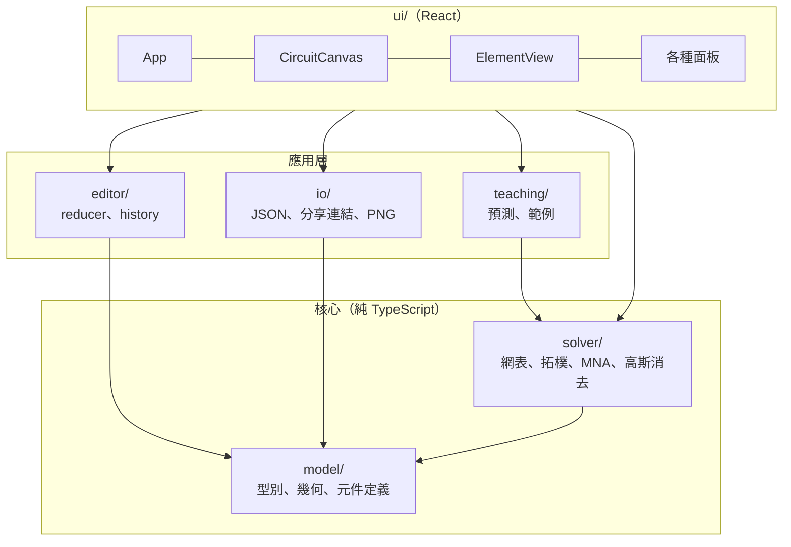
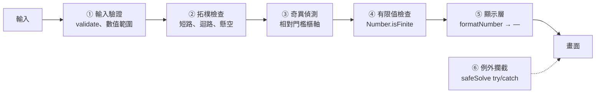

# 第 3 章　架構設計

> **本章目標**
>
> - 從非功能需求推導出架構目標
> - 理解分層架構與「依賴方向」
> - 學會用 ADR（Architecture Decision Record）記錄設計決策
> - 用多道防線處理不可信的輸入與數值風險

## 3.1 從需求推導架構目標

架構不是憑喜好挑一個「看起來很專業」的樣式，而是從需求推導出來的。先把第 1 章的非功能需求翻譯成架構目標：

| 需求                              | 架構目標                                   | 具體手段                                      |
| --------------------------------- | ------------------------------------------ | --------------------------------------------- |
| N2、N3 數值正確、1,000 個隨機電路 | **求解器可以被大量、快速地測試**           | 求解器不依賴 React 與 DOM，在 Node 中直接執行 |
| N1 任何接法都不能當掉             | **強健性**                                 | 多道防線（第 3.6 節）                         |
| F11 Undo、F12 存檔還原後完全相同  | **決定性**（同樣的輸入一定得到同樣的輸出） | 純函式、不可變資料、固定排序                  |
| N4 200 個元件 < 100 ms            | **效能**                                   | 依連通分量求解、最小化重繪                    |
| 維護者的需求                      | **可讀、可擴充**                           | 模組職責單一、依賴方向固定                    |

在多個目標衝突時，本專案採用的優先順序是：

1. **可測試性**：容易測試嗎？
2. **可讀性**：六個月後還看得懂嗎？
3. **一致性**：符合專案現有的模式嗎？
4. **簡單性**：是最簡單的可行方案嗎？
5. **可逆性**：之後要改有多難？

把可測試性排第一，是因為這個專案的驗收標準幾乎都要求「並有測試」。一個難以測試的設計，就算寫得再漂亮，也無法證明它符合需求。

## 3.2 分層與依賴方向

**依賴只能由上往下。** `solver/` 不知道 React 的存在，`model/` 不知道求解器的存在。

這個規則帶來的好處：

- **測試**：`solver/` 和 `model/` 可以在 Node 中測試，不需要瀏覽器。1,000 個隨機電路的性質測試只要 0.1 秒。
- **替換**：如果將來要把 UI 從 React 換成別的框架，`solver/` 完全不用動。
- **理解**：讀求解器時，不需要知道任何 UI 細節。

> **怎麼確保沒有人違反規則？** 本專案目前靠程式碼審查。比較大的專案可以用 ESLint 的 `import/no-restricted-paths` 規則或 dependency-cruiser 自動檢查，這是第 9 章的一道練習題。

### 「純函式核心，命令式外殼」

這個分層有一個常見的名字：**Functional Core, Imperative Shell**。

- **核心**（`model/`、`solver/`、`editor/reducer.ts`、`teaching/prediction.ts`）全部是純函式：同樣的輸入一定得到同樣的輸出，不讀寫外部狀態，不碰 DOM。
- **外殼**（`ui/`、`io/exportPng.ts`）負責所有「髒活」：事件處理、DOM 操作、下載檔案、剪貼簿。

核心的程式碼量佔大多數，而且是最容易出錯的部分（演算法），所以把它們做成純函式，就能用最便宜的方式（單元測試）測試最重要的邏輯。

## 3.3 模組職責

| 模組                 | 職責                             | 主要對外介面                                | 不負責             |
| -------------------- | -------------------------------- | ------------------------------------------- | ------------------ |
| `model/types.ts`     | 定義資料結構                     | `Circuit`、`CircuitElement`                 | 任何邏輯           |
| `model/elements.ts`  | 元件預設值、數值範圍、旋轉與位移 | `createElement`、`rotate90`、`VALUE_RANGES` | 求解               |
| `solver/netlist.ts`  | 格點 → 超節點                    | `buildNetlist`                              | 判斷錯誤           |
| `solver/topology.ts` | 拓樸檢查：電池接法、懸空元件     | `analyzeSources`、`findDangling`            | 解方程式           |
| `solver/mna.ts`      | 建立並求解 MNA 方程組            | `solveMna`                                  | 知道「元件」是什麼 |
| `solver/linalg.ts`   | 解線性方程組                     | `solveLinearSystem`                         | 知道「電路」是什麼 |
| `solver/solve.ts`    | 串起整條求解管線                 | `solve(circuit): SolveResult`               | 畫面               |
| `editor/reducer.ts`  | 所有編輯動作與歷史               | `editorReducer`                             | 求解               |
| `io/serialize.ts`    | JSON 序列化與驗證                | `serializeCircuit`、`parseCircuit`          | 檔案下載           |
| `ui/*`               | 畫面與互動                       | React components                            | 業務邏輯           |

注意「不負責」這一欄。`linalg.ts` 不知道它解的是電路方程式，所以第 6.5 節的 0 Ω 電流分配也可以重複使用它。`mna.ts` 不知道「電阻」和「燈泡」的差別，它只看到「電導值」，因為對求解來說燈泡就是電阻。**模組知道得越少，越容易重複使用。**

## 3.4 架構決策紀錄（ADR）

ADR 是一種記錄設計決策的格式，每份 ADR 包含：背景、考慮過的選項、決定、後果。它的價值在於**記錄「為什麼」**。六個月後有人問「為什麼不用 Canvas？」，答案就在這裡，不需要靠記憶。

以下是本專案最重要的 8 個決策。

### ADR-1：求解結果是衍生資料，不存進 state

- **背景**：需要 Undo 和存檔還原後，結果完全相同。
- **選項**：
  - A. 每次編輯後在 reducer 中求解，把結果存進 state。
  - B. 結果不存進 state，每次渲染時用 `useMemo(() => solve(circuit))` 計算。
- **決定**：B。
- **後果**：
  - ✅ Undo、存檔只需處理 `Circuit`，結果必然一致。
  - ✅ reducer 保持簡單，只負責改資料。
  - ⚠️ 每次編輯都要完整求解一次。因為求解只要 0.2 ms，可以接受。

### ADR-2：0 Ω 元件以「縮合」處理，而非當成 0 V 電壓源

- **背景**：導線、電流計、閉合的開關電阻為 0，不能用電導 1/R 寫進矩陣。
- **選項**：
  - A. 當成 0 V 的電壓源，每個元件多一個電流未知數。這是許多教科書的標準作法。
  - B. 用 union-find 把它們兩端的點合併成「超節點」，不放進矩陣，求解後再分配電流。
- **決定**：B。
- **後果**：
  - ✅ 學生多畫一條平行導線時，A 會形成「電壓源迴路」而讓矩陣奇異；B 不受影響。
  - ✅ 矩陣比較小（200 元件的電路中，大部分是導線）。
  - ⚠️ 需要額外的演算法分配 0 Ω 元件的電流（第 6.5 節）。

> **教學討論**：選項 A 是教科書的作法，為什麼這裡不用？因為教科書的電路是「專家畫的乾淨電路」，而這個系統的輸入是「學生畫的電路」。**同一個演算法，在不同的輸入分布下，適合程度完全不同。**

### ADR-3：依連通分量分開求解

- **背景**：同一張畫布可能有兩組互不相連的電路。
- **選項**：
  - A. 所有元件建成一個大矩陣，整張畫布只有一個接地點。
  - B. 先找出連通分量，每個分量各自建矩陣、各自選接地點。
- **決定**：B。
- **後果**：
  - ✅ A 的問題：兩組電路之間沒有連接，其中一組相對於接地點的電位不確定，矩陣奇異。B 沒有這個問題。
  - ✅ 合併求解與分開求解建出來的子矩陣**完全相同**，結果位元級相同（驗收標準要求）。
  - ✅ 一組接錯只影響那一組（第 2.7 節的分析結論）。
  - ✅ 效能：成本從 O(N³) 降為 Σ O(nᵢ³)。

### ADR-4：不可變資料 + 快照式歷史

- **背景**：需要 Undo／Redo 至少 50 步。
- **選項**：
  - A. Command pattern：每個操作記錄 `do()` 和 `undo()`。
  - B. 快照：每次編輯保存整個 `Circuit`。因為資料不可變，未修改的元件物件在快照之間共用。
- **決定**：B。
- **後果**：
  - ✅ 不可能寫錯 `undo()`，因為根本不用寫。
  - ✅ 共用未修改的物件，100 步 × 200 個元件，記憶體只多出被修改的部分。
  - ⚠️ 每次編輯要複製元件陣列（O(n)），200 個元件可以忽略。

### ADR-5：用 SVG 而非 Canvas 繪圖

- **選項**：SVG（DOM 元素）或 Canvas（點陣繪圖）。
- **決定**：SVG。
- **後果**：
  - ✅ 每個元件是 DOM 元素，滑鼠事件直接由瀏覽器分派，不需要自己做「點到哪個元件」的碰撞偵測。
  - ✅ 向量圖，投影時任意縮放都清楚。
  - ✅ 可以用 CSS 動畫做流動點（第 5.5 節）。
  - ✅ E2E 測試可以直接讀 DOM 屬性（例如 `data-reading`）。
  - ⚠️ 元件數量到數千個時會比 Canvas 慢。需求只有 200 個，沒有問題。

### ADR-6：在主執行緒同步求解，不用 Web Worker

- **決定**：主執行緒。
- **理由**：求解 0.2 ms，遠低於一幀的 16 ms；同步的程式碼比較好寫、比較好測試。
- **可逆性**：求解器是純函式，將來需要時，把 `solve()` 搬進 Worker 只需要改呼叫端。

### ADR-7：錯誤偵測放在拓樸階段，而非依賴矩陣奇異

- **背景**：短路、電池矛盾等錯誤接法都會讓矩陣奇異。
- **選項**：
  - A. 直接解矩陣，奇異時回報「無法計算」。
  - B. 解矩陣之前，先從電路的連接方式（拓樸）判斷錯誤。
- **決定**：B，並保留 A 作為最後一道防線。
- **後果**：
  - ✅ A 只知道「矩陣奇異」，不知道**是哪個元件、什麼原因**，無法產生「電流計直接接在電池兩端」這種具體說明。
  - ✅ 拓樸判斷是精確的整數運算，不受浮點誤差影響。
  - ⚠️ 要為每一種錯誤寫專門的偵測演算法（第 6.6、6.7 節）。

### ADR-8：分享連結放在網址 hash，使用瀏覽器原生壓縮

- **選項**：
  - A. 後端存電路，連結只放 id（需要後端，違反限制）。
  - B. 電路放在 query string（`?c=...`）。
  - C. 電路放在 hash（`#c=...`），用 `CompressionStream` 壓縮。
- **決定**：C。
- **後果**：
  - ✅ hash 不會送到伺服器，靜態主機（GitHub Pages）不需要任何設定。
  - ✅ 原生 API，不需要壓縮套件。Node 18 以上也有，所以可以寫單元測試。
  - ⚠️ 只改 hash 時瀏覽器不會重新載入頁面，必須監聽 `hashchange`。**這一點在設計時漏掉了，驗收測試才發現**（第 8 章故事 6）。這是很好的教訓：每個決定的後果都要追問到底。

## 3.5 多道防線（Defense in Depth）

需求 N1 要求「任何接法都不可以讓畫面當掉，也不可以顯示 NaN 或 Infinity」。只靠一道防線是不夠的，因為任何一道都可能有疏漏。本系統設了五道：

| 防線         | 位置                                   | 擋下什麼                                                              |
| ------------ | -------------------------------------- | --------------------------------------------------------------------- |
| ① 輸入驗證   | `io/serialize.ts`、`model/elements.ts` | 負的電阻、字串、超出畫布的座標。數值範圍也限制了矩陣的條件數          |
| ② 拓樸檢查   | `solver/topology.ts`                   | 所有已知會讓矩陣奇異的接法，並產生具體說明                            |
| ③ 奇異偵測   | `solver/linalg.ts`                     | 拓樸檢查沒想到的情況：樞軸太小就回報，不硬除                          |
| ④ 有限值檢查 | `solver/solve.ts`                      | 任何計算結果出現非有限值，該分量改判為錯誤                            |
| ⑤ 顯示層     | `format.ts`                            | 所有顯示的數字都經過 `formatNumber`，非有限值一律顯示「—」            |
| ⑥ 例外攔截   | `ui/App.tsx` 的 `safeSolve`            | 求解器若有未預期的程式錯誤，改顯示錯誤訊息，並用 `console.error` 記錄 |

第 ⑥ 道值得特別討論。專案規範要求「禁止無聲吞掉 exception」，`safeSolve` 有沒有違反？沒有，因為它：

1. 用 `console.error` 記錄完整的錯誤，開發者看得到。
2. 在畫面上顯示錯誤訊息，使用者也知道出了問題。

「吞掉」指的是 catch 之後什麼都不做，讓錯誤消失得無聲無息；這裡是把錯誤**轉換**成另一種可見的形式。

## 本章重點

1. 架構從非功能需求推導，並明訂衝突時的優先順序。
2. 依賴方向固定由上往下；核心做成純函式，最容易測試的部分正好是最重要的部分。
3. 用 ADR 記錄「考慮過哪些選項、為什麼選這個、有什麼後果」。
4. 同一個演算法，在不同的輸入分布下適合程度不同（ADR-2）。
5. 強健性靠多道防線，而不是寄望某一道完美無缺。

## 練習

1. **（ADR 撰寫）** 本專案沒有使用狀態管理套件（Redux、Zustand），只用 `useReducer`。請為這個決定寫一份 ADR，包含至少兩個選項。
2. **（依賴方向）** 如果有人在 `solver/solve.ts` 中 `import { COLORS } from '../ui/colors'`，會破壞什麼？舉出兩個具體的後果。
3. **（取捨）** ADR-4 選擇了快照式歷史。如果電路有 10,000 個元件，這個決定還成立嗎？請估算記憶體用量，並提出替代方案。
4. **（防線）** 假設某天有人把 `VALUE_RANGES` 中電阻的下限從 0.01 改成 0，哪幾道防線會被影響？系統還會正常嗎？（提示：電導 1/0 = Infinity。）
5. **（追問後果）** ADR-8 漏掉了 `hashchange` 的後果。請用同樣的方法檢查 ADR-5：選擇 SVG 有沒有什麼後果是表格裡沒寫到的？
