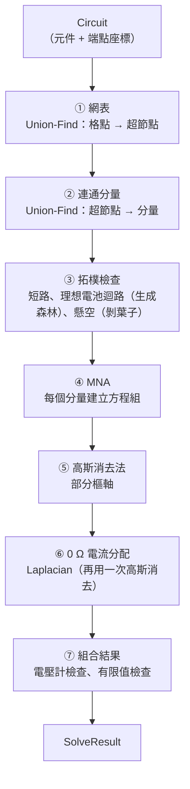

# 第 6 章　核心演算法

> **本章目標**
>
> - 理解並能實作 Union-Find（併查集）
> - 從克希荷夫定律推導出 MNA 方程組
> - 理解部分樞軸高斯消去法，以及為什麼需要「部分樞軸」
> - 把「欠定問題」轉換成最佳化問題，再轉換成線性方程組
> - 用圖論演算法偵測錯誤接法
> - 分析演算法的複雜度與數值穩定性

本章的每個演算法都依同樣的順序說明：**要解決什麼問題 → 想法 → 程式碼 → 手算範例 → 複雜度**。建議準備紙筆，跟著手算一遍。

## 6.0 求解管線總覽



| 步驟              | 演算法                | 時間複雜度                        | 檔案                  |
| ----------------- | --------------------- | --------------------------------- | --------------------- |
| ① 網表            | Union-Find            | O(E · α(P))                       | `netlist.ts`          |
| ② 連通分量        | Union-Find            | O(E · α(S))                       | `solve.ts`            |
| ③ 拓樸檢查        | BFS、生成森林、剝葉子 | O(E + P)                          | `topology.ts`         |
| ④⑤ MNA + 高斯消去 | 部分樞軸高斯消去      | Σ O(nᵢ³)，nᵢ 為各分量的未知數個數 | `mna.ts`、`linalg.ts` |
| ⑥ 0 Ω 電流分配    | Laplacian + 高斯消去  | Σ O(kⱼ³)，kⱼ 為各超節點內的格點數 | `zeroOhmFlow.ts`      |
| ⑦ 組合結果        | 線性掃描              | O(E)                              | `solve.ts`            |

E 是元件數，P 是格點數，S 是超節點數，α 是反阿克曼函數（實務上 ≤ 4，可視為常數）。

## 6.1 Union-Find（併查集）

### 問題

給一群「點」和一串「把兩個點連起來」的操作，要能快速回答：「這兩個點是否相連？」

本專案中有三個地方遇到這個問題：

1. 哪些格點被導線（0 Ω 元件）連在一起？→ 超節點
2. 哪些超節點被電阻、電池連在一起？→ 連通分量
3. 理想電池有沒有形成迴路？→ 錯誤偵測

### 想法

把每個集合表示成一棵樹，樹根就是集合的「代表」。

- `find(x)`：從 x 一路往上走到樹根，回傳樹根。
- `union(a, b)`：找到兩者的樹根；如果不同，就把其中一個樹根接到另一個下面。
- 兩個點相連 ⇔ `find(a) === find(b)`。

### 程式碼（`src/solver/unionFind.ts`）

```ts
export class UnionFind {
  private readonly parent: Int32Array;

  constructor(size: number) {
    this.parent = new Int32Array(size);
    for (let i = 0; i < size; i++) this.parent[i] = i; // 每個點自成一個集合
  }

  find(i: number): number {
    let root = i;
    while (this.parent[root] !== root) root = this.parent[root] as number;
    // 路徑壓縮：把沿路的每個點直接接到樹根
    let node = i;
    while (node !== root) {
      const next = this.parent[node] as number;
      this.parent[node] = root;
      node = next;
    }
    return root;
  }

  /** 合併兩個集合；原本就在同一集合時回傳 false。 */
  union(a: number, b: number): boolean {
    const ra = this.find(a);
    const rb = this.find(b);
    if (ra === rb) return false;
    // 讓編號較小的當根，結果與合併順序無關
    if (ra < rb) this.parent[rb] = ra;
    else this.parent[ra] = rb;
    return true;
  }
}
```

兩個值得注意的設計：

- **路徑壓縮**：`find` 走過的點都直接接到樹根，下次查詢只要一步。這讓攤銷成本接近常數。
- **`union` 的回傳值**：回傳 `false` 代表「兩點原本就相連」。在偵測迴路時，這就是「加入這條邊會形成迴路」的訊號（第 6.7 節）。

> **教學提示**：標準教科書的 Union-Find 會用「依秩合併」（union by rank）讓樹保持矮胖。本專案改用「編號小的當根」，是為了讓結果具有**決定性**：不管元件以什麼順序加入，每個集合的代表都是編號最小的點。單獨使用路徑壓縮時，攤銷複雜度是 O(log n)，對本專案的規模來說已經足夠。

### 手算範例：建立網表

考慮一個串聯電路：電池、電阻 R1、電阻 R2，用 3 條導線連接。

```
格點：  P0 ──R1── P1 ──w1── P2 ──R2── P3
         │                              │
        w3                             w2
         │                              │
        P5 ──────────電池────────────── P4
       (−)                              (+)
```

1. 每個被用到的格點編號：P0…P5。
2. 只對 0 Ω 元件（w1、w2、w3）執行 `union`：
   - `union(P1, P2)` → {P1, P2}
   - `union(P3, P4)` → {P3, P4}
   - `union(P0, P5)` → {P0, P5}
3. 得到 3 個超節點：S0 = {P0, P5}、S1 = {P1, P2}、S2 = {P3, P4}。

接下來求解時，只需要處理 3 個超節點和 3 個導電元件（R1、R2、電池），完全不用管導線。

## 6.2 從克希荷夫定律到 MNA

### 節點電壓法

國中學過歐姆定律 V = IR。改寫成「電流 = 電導 × 電壓差」：

$$I_{i \to j} = G \cdot (V_i - V_j), \quad G = \frac{1}{R}$$

對每個節點寫 KCL：**從節點流出的電流總和為 0**。如果所有元件都是電阻，每條方程式都只含節點電壓，未知數個數 = 節點數 − 1（扣掉接地點，接地點電位定為 0）。

### 電壓源的問題

電池的電流**無法用兩端電壓表示**。理想電池不論電流多大，兩端電壓都是 E。所以「流過電池的電流」必須當成**額外的未知數**，再補上一條**支路方程式**描述電池本身。這就是 Modified Nodal Analysis（修正節點分析法）中「Modified」的意思。

本專案的電池模型是「理想電壓源串聯內電阻」：

$$V_+ - V_- = E - r \cdot I \quad\Longleftrightarrow\quad V_+ - V_- + r \cdot I = E$$

其中 I 是電池內部由負極流向正極的電流。r = 0 時，這條式子就退化成理想電壓源，**同一條公式，不需要特例**。

### 蓋章（stamping）

MNA 最優雅的地方在於：每個元件對矩陣的貢獻是一個固定的「圖章」，逐一蓋上去就完成了。

**電阻**（電導 G，接在節點 i、j 之間）：

|          | 欄 i | 欄 j |
| -------- | ---- | ---- |
| **列 i** | +G   | −G   |
| **列 j** | −G   | +G   |

**電池**（負極 p、正極 q，電流未知數在第 k 欄）：

|                        | 欄 p | 欄 q | 欄 k | 右側 |
| ---------------------- | ---- | ---- | ---- | ---- |
| **列 p**（KCL）        |      |      | +1   |      |
| **列 q**（KCL）        |      |      | −1   |      |
| **列 k**（支路方程式） | −1   | +1   | r    | E    |

接地點對應的列和欄直接略過。程式碼（`src/solver/mna.ts`）幾乎就是這兩張表的直譯：

```ts
if (branch.kind === 'resistive') {
  const g = branch.conductance;
  add(i, i, g);
  add(j, j, g);
  add(i, j, -g);
  add(j, i, -g);
} else {
  // KCL：I 由 sa 流入電源、由 sb 流出
  add(i, k, 1);
  add(j, k, -1);
  // 支路方程式：V(sb) − V(sa) + r·I = emf
  add(k, j, 1);
  add(k, i, -1);
  add(k, k, branch.internalR);
  rhs[k] = branch.emf;
  k++;
}
```

`add()` 遇到索引 −1（接地點）時會直接略過，所以程式不需要為接地點寫特例。

### 手算範例：12 V 串聯 4 Ω 與 8 Ω

超節點：S⁻（電池負極，接地）、S⁺（電池正極）、Sₘ（兩個電阻之間）。
未知數：x = [V⁺, Vₘ, I]。

逐一蓋章：

- R₄（S⁺ → Sₘ，G = 0.25）：列 0 欄 0 加 0.25、列 0 欄 1 減 0.25；列 1 欄 0 減 0.25、列 1 欄 1 加 0.25。
- R₈（Sₘ → 接地，G = 0.125）：只有列 1 欄 1 加 0.125。
- 電池（負極 = 接地，正極 = S⁺，k = 2）：列 0 欄 2 加 −1；列 2 欄 0 加 +1；右側 12。

得到：

$$
\begin{bmatrix} 0.25 & -0.25 & -1 \\ -0.25 & 0.375 & 0 \\ 1 & 0 & 0 \end{bmatrix}
\begin{bmatrix} V^+ \\ V_m \\ I \end{bmatrix}
=
\begin{bmatrix} 0 \\ 0 \\ 12 \end{bmatrix}
$$

由第 3 列得 V⁺ = 12；代入第 2 列得 Vₘ = 0.25 × 12 / 0.375 = 8；代入第 1 列得 I = 0.25 × (12 − 8) = 1。

所以 I = 1 A，R₄ 兩端 12 − 8 = 4 V，R₈ 兩端 8 V，與國中手算的結果完全相同。測試 `solve.textbook.test.ts` 驗證的就是這組數字。

## 6.3 部分樞軸高斯消去法

### 演算法

解 A·x = b 的高斯消去法分兩個階段：

1. **前向消去**：對每一欄，用「樞軸列」把下方各列在這一欄的係數消成 0，得到上三角矩陣。
2. **回代**：從最後一列開始，逐一求出未知數。

**部分樞軸**（partial pivoting）是在前向消去的每一步，先從這一欄「目前這一列以下」的所有列中，挑出絕對值最大的那一列，和目前這一列交換，再拿它當樞軸。

```text
for col = 0 .. n−1:
    pivotRow = argmax_{r ≥ col} |A[r][col]|        ← 部分樞軸
    if |A[pivotRow][col]| ≤ 門檻: 回報奇異
    交換第 col 列與第 pivotRow 列
    for r = col+1 .. n−1:
        factor = A[r][col] / A[col][col]
        第 r 列 −= factor × 第 col 列
for i = n−1 .. 0:                                  ← 回代
    x[i] = (b[i] − Σ_{j>i} A[i][j]·x[j]) / A[i][i]
```

### 為什麼需要部分樞軸？理由一：避免除以 0

MNA 矩陣中，理想電池（r = 0）那一列的對角線是 0。如果剛好輪到它當樞軸，不換列就會除以 0。測試中就有這樣一個例子：

$$\begin{bmatrix} 0 & 1 & 1 \\ 1 & 0 & 1 \\ 1 & 1 & 0 \end{bmatrix}$$

第一步的樞軸 A[0][0] = 0，必須和下面的列交換才能繼續。

### 為什麼需要部分樞軸？理由二：數值穩定（更重要）

考慮這個方程組，其中 ε = 10⁻²⁰：

$$\begin{bmatrix} \varepsilon & 1 \\ 1 & 1 \end{bmatrix} \begin{bmatrix} x_1 \\ x_2 \end{bmatrix} = \begin{bmatrix} 1 \\ 2 \end{bmatrix}$$

正確答案約為 x₁ ≈ 1、x₂ ≈ 1。

**不換列**：factor = 1/ε = 10²⁰。第二列變成 [0, 1 − 10²⁰ | 2 − 10²⁰]。在雙精度浮點數中，1 − 10²⁰ 和 2 − 10²⁰ 都會被捨入成 −10²⁰，於是 x₂ = 1。回代得到 x₁ = (1 − 1) / ε = **0**，完全錯誤。

**換列後**：樞軸變成 1，factor = ε。第二列變成 [0, 1 − ε | 1 − 2ε] ≈ [0, 1 | 1]，x₂ = 1、x₁ = 2 − 1 = **1**，正確。

問題的根源是：**除以很小的樞軸，會把捨入誤差放大成很大的數**，蓋過真正的資訊。部分樞軸保證每一步的 |factor| ≤ 1，誤差就不會被放大。

這在電路中是真實存在的情況：同一個電路可能同時有 0.01 Ω 和 1 MΩ 的元件，電導值相差 10⁸ 倍。測試 `數值範圍相差很大時（1 MΩ 與 0.01 Ω 並存）殘差仍很小` 驗證的就是這一點。

### 手算範例：延續 12 V 串聯

$$
\left[\begin{array}{ccc|c} 0.25 & -0.25 & -1 & 0 \\ -0.25 & 0.375 & 0 & 0 \\ 1 & 0 & 0 & 12 \end{array}\right]
$$

**第 0 欄**：|0.25|、|−0.25|、|1| 中最大的是第 2 列 → 和第 0 列交換：

$$
\left[\begin{array}{ccc|c} 1 & 0 & 0 & 12 \\ -0.25 & 0.375 & 0 & 0 \\ 0.25 & -0.25 & -1 & 0 \end{array}\right]
$$

消去：第 1 列 += 0.25 × 第 0 列；第 2 列 −= 0.25 × 第 0 列：

$$
\left[\begin{array}{ccc|c} 1 & 0 & 0 & 12 \\ 0 & 0.375 & 0 & 3 \\ 0 & -0.25 & -1 & -3 \end{array}\right]
$$

**第 1 欄**：|0.375| > |−0.25|，不換列。第 2 列 −= (−0.25 / 0.375) × 第 1 列：

$$
\left[\begin{array}{ccc|c} 1 & 0 & 0 & 12 \\ 0 & 0.375 & 0 & 3 \\ 0 & 0 & -1 & -1 \end{array}\right]
$$

**回代**：I = −1 / −1 = 1；Vₘ = 3 / 0.375 = 8；V⁺ = 12。與第 6.2 節的結果相同。

### 奇異的判定：相對門檻

```ts
/** 樞軸絕對值低於「矩陣最大元素 × 此比例」即視為奇異。 */
const SINGULAR_RELATIVE_TOLERANCE = 1e-13;
```

為什麼不用固定的門檻（例如 1e-12）？因為電導值的大小會隨電路改變。如果電路中所有電阻都是 1 MΩ，電導是 1e-6，正常的樞軸本來就很小；固定門檻可能把正常的矩陣誤判為奇異。**相對門檻**是以矩陣本身的尺度為基準，不受單位與數量級影響。

### 複雜度

前向消去約 (2/3)·n³ 次浮點運算，回代 n² 次。對 n = 150，約 225 萬次運算，在 JavaScript 中不到 1 毫秒。

> **進階討論**：MNA 矩陣大部分元素是 0（稀疏矩陣）。大型電路模擬器（例如 SPICE）會用稀疏 LU 分解，複雜度遠低於 O(n³)。本專案的規模用稠密矩陣就足夠，程式也簡單得多。這是第 9 章的一道進階練習。

## 6.4 連通分量與接地點

每個連通分量需要**自己的接地點**。如果兩組互不相連的電路共用一個接地點，另一組電路的電位相對於這個接地點就沒有定義，矩陣會出現整列整欄都是 0 的區塊，變成奇異。

```ts
net.roles.forEach((_, i) => {
  if (!isConductive(i)) return;
  const [sa, sb] = supernodesOf(net, i);
  assign(sa);
  assign(sb).conductive.push(i);
});
```

`findComponents` 依**導電元件的出現順序**收集每個分量的超節點，第一個收集到的就是接地點。這個順序有一個重要性質：

> 把電路 A 和電路 B 合併到同一張畫布上，A 的元件在合併後的相對順序不變，所以 A 的分量收集到的超節點順序也不變，建出來的子矩陣**一模一樣**。

這就是「合併求解與分開求解結果完全相同」的數學基礎。測試用的是 `toEqual`（完全相等），不是「誤差在 1e-12 以內」。性質測試以 1,000 對隨機電路驗證了這一點。

注意只收集**導電元件**（電阻、燈泡、電池）的端點，不包括電壓計。所以在電路上加一個電壓計，不會改變超節點的順序，也就不會改變矩陣。

## 6.5 0 Ω 元件的電流分配

### 問題

導線被縮合進超節點後，MNA 不會算出它們的電流。但畫面上需要顯示每條導線的流動點，電流計也需要讀數。

已知條件：每個格點流向「非 0 Ω 元件」的電流（稱為注入電流）。要求：每條 0 Ω 邊的電流 f，讓每個格點都滿足 KCL。

### 這是一個欠定問題

如果超節點內部的導線形成樹狀結構，解是唯一的：從樹葉往樹根逐一推算即可。但只要有迴路（例如兩條並聯的導線），解就有無限多個：電流在迴路中多繞一圈，KCL 仍然成立。

一個連通圖的獨立迴路數 = 邊數 − 點數 + 1。兩條並聯導線（2 條邊、2 個點）有 1 個迴路，所以有 1 個自由度。

### 想法：選「最自然」的那個解

物理上，理想導線的電流分配確實無法決定。但如果想像每條導線都有**相同的極小電阻**，電流就會依「最省能量」的方式分配，並聯導線會平分電流。這個解在數學上是：

$$\min \sum_e f_e^2 \quad \text{subject to} \quad \text{每個格點的 KCL}$$

用拉格朗日乘數法可以證明（這就是 Thomson 原理），最佳解一定可以寫成：

$$f_e = \varphi_a - \varphi_b$$

也就是**每條邊的電流等於兩端某個「位勢」φ 的差**。代回 KCL，就得到 Laplacian 方程組：

$$L \cdot \varphi = -\text{injection}$$

其中 L 是圖的 Laplacian 矩陣：對角線是每個點連接的邊數，非對角線是 −（兩點之間的邊數）。這和「每條邊的電導都是 1」的 MNA 完全一樣，所以可以**重複使用同一個高斯消去法**。

### 程式碼（`src/solver/zeroOhmFlow.ts`，節錄）

```ts
const rhs = points.map((p) => -injection(p));
if (rhs.every((v) => v === 0)) return edges.map(() => 0); // 沒有電流，直接回傳

// 以第一個格點為參考（φ = 0），刪去其方程式
for (const edge of edges) {
  const i = localOf(edge.pa);
  const j = localOf(edge.pb);
  add(i, i, 1);
  add(j, j, 1);
  add(i, j, -1);
  add(j, i, -1);
}
const solution = solveLinearSystem(L, rhs.slice(1));
const phi = [0, ...solution.x];
return edges.map((e) => phi[localOf(e.pa)] - phi[localOf(e.pb)]);
```

### 手算範例：兩條並聯導線

超節點內有兩個格點 P、Q，兩條導線 w1、w2 都從 P 連到 Q。電池送 2 A 進入 P，電阻從 Q 拿走 2 A。

- 注入電流（流向非 0 Ω 元件）：injection(P) = −2（電流從電池流**進** P），injection(Q) = +2。
- Laplacian：兩條邊都連接 P、Q，所以 L = [[2, −2], [−2, 2]]。
- 以 P 為參考（φ_P = 0），只保留 Q 的方程式：2·φ_Q = −2 → φ_Q = −1。
- 電流：f_w1 = f_w2 = φ_P − φ_Q = 1 A。

兩條導線各分到 1 A。測試 `兩條並聯導線平分電流，且每個格點都滿足 KCL` 驗證的就是這個情況。

> **重點**：一個看似需要「特殊規則」的問題（迴路中的電流怎麼分），被轉換成「最佳化問題」，再轉換成「已經會解的線性方程組」。把新問題化約成已知問題，是演算法設計最重要的思考方式之一。

## 6.6 錯誤偵測一：理想電池短路

如果 r = 0 的電池兩極落在**同一個超節點**，代表兩極之間只有 0 Ω 的路徑，也就是短路。支路方程式變成：

$$V_+ - V_+ + 0 \cdot I = E \quad\Rightarrow\quad 0 = E$$

這是矛盾的，矩陣必然奇異。偵測方法非常簡單：網表建好之後，檢查 `sa === sb`。

為了在畫面上標出**整條短路路徑**，程式用 BFS 在超節點內沿 0 Ω 元件找出一條從負極到正極的路徑。如果路徑上有電流計，就改用「電流計的電阻是 0……」這則說明，讓學生知道問題出在電流計的接法。

r > 0 的電池被短路時，支路方程式是 r·I = E，可以解出 I = E/r。這不是錯誤，但電流很大，所以只給警告。

## 6.7 錯誤偵測二：理想電池迴路

### 問題

r = 0 的電池固定了兩端的電位差。如果多個理想電池形成迴路，迴路上的電位差必須互相吻合（KVL），否則就是矛盾。

### 步驟一：合併並聯的電池

先把接在**同一對超節點**上的理想電池分成一組：

- 電動勢一致（考慮方向後）→ 合併成一條電壓源支路，求解後把電流平分給各電池。這是國中課本「電池並聯」的情境。
- 電動勢不一致 → `CONFLICTING_SOURCES`（兩個電壓不同的電池直接並聯）。

### 步驟二：用生成森林偵測迴路

把每一組理想電池當成超節點之間的一條邊，這條邊帶有「電位上升量」E。逐一加入邊，用 Union-Find 判斷：

- 兩端原本不相連 → 加入森林。
- 兩端原本已經相連 → **形成迴路**。在森林中用 BFS 找出原本那條路徑，累加路徑上的電位上升量，和這條新邊比較：
  - 相等 → 電位吻合，但各電池的電流無法決定 → `SOURCE_LOOP`。
  - 不相等 → KVL 矛盾 → `CONFLICTING_SOURCES`。

```ts
for (const group of consistent) {
  if (uf.union(group.sa, group.sb)) {
    link(group.sa, group.sb, group.emf, group); // 正向：電位上升 E
    link(group.sb, group.sa, -group.emf, group); // 反向：電位下降 E
    continue;
  }
  // 形成迴路：BFS 找森林中 sa → sb 的路徑，累加 rise
  // ……
  const code = nearlyEqual(rise, group.emf) ? 'SOURCE_LOOP' : 'CONFLICTING_SOURCES';
}
```

### 手算範例

三個理想電池：E1（節點 0 → 1，3 V）、E2（節點 1 → 2，3 V）、E3（節點 0 → 2，6 V）。

1. 加入 E1：0、1 不相連 → 加入森林。
2. 加入 E2：1、2 不相連 → 加入森林。
3. 加入 E3：0、2 已經相連（0 → 1 → 2）→ 迴路！
   - 森林路徑 0 → 1 → 2 的電位上升量 = 3 + 3 = 6 V。
   - E3 的電位上升量 = 6 V。
   - 相等 → `SOURCE_LOOP`（電位吻合，但電流無法決定）。

如果 E3 改成 5 V：6 ≠ 5 → `CONFLICTING_SOURCES`。這兩個情況都是 `solve.diagnostics.test.ts` 中的測試案例。

## 6.8 錯誤偵測三：剝葉子找出懸空元件

### 問題

需求要求標出「只接了一端、懸空的元件」。最直接的定義是「某個端點所在的格點只有它自己」。但考慮這個情況：

```
電路 ── R ── 導線 ── （空）
```

導線的一端懸空，所以導線是懸空元件。但電阻 R 呢？它的兩端都有接東西，可是電流也不可能流過它。

### 想法：反覆剝掉葉子

把「格點」當成圖的頂點、「元件」當成邊。一個元件如果有一端的格點**度數為 1**（只有它自己），它就是「葉子」。把葉子移除後，原本和它相連的格點度數會減 1，可能又產生新的葉子。重複這個過程，直到沒有葉子為止，所有被移除的元件都是懸空元件。

```ts
const queue: number[] = [];
for (let p = 0; p < net.pointCount; p++) if (degree[p] === 1) queue.push(p);

while (queue.length > 0) {
  const p = queue.shift() as number;
  const element = elementsAt[p]?.find((i) => !removed[i]);
  if (element === undefined) continue;
  removed[element] = 1;
  dangling.push(element);
  for (const q of [net.pointA[element], net.pointB[element]]) {
    degree[q] -= 1;
    if (degree[q] === 1) queue.push(q); // 產生新的葉子
  }
}
```

在上面的例子中：導線先被剝掉 → 它和 R 之間的格點度數變成 1 → R 也被剝掉。整串懸空的元件都被找出來了。

這個演算法在圖論中的名稱是**求 2-core**：反覆移除度數小於 2 的頂點後，剩下的部分就是 2-core。每個元件最多被移除一次，每個格點最多被檢查有限次，所以時間複雜度是 O(E + P)。

懸空元件在拓樸上**不可能有電流**，所以求解後把它們的電流直接設為 0。這消除了浮點殘差，否則畫面上可能出現 −1.8 × 10⁻¹⁶ 這種數字（第 8 章故事 2）。

## 6.9 錯誤偵測四：電壓計串聯（啟發式）

### 為什麼只能用啟發式？

「電壓計並聯在電阻兩端」和「電壓計串聯在迴路中」，在**拓樸上**長得很像：兩種情況下，電壓計兩端之間都存在一條導電路徑。所以單看接線方式分不出來，只能從求解結果推斷。

### 規則

電壓計滿足以下**全部**條件時，判定為串聯：

1. 讀數不為 0（|V| > 10⁻⁹）。
2. 沒有任何其他元件和它**直接並聯**（接在同一對超節點上）。
3. 它至少有一端，除了電壓計本身之外，**完全沒有電流**流過。

條件 3 是核心：串聯時，電流原本應該流過電壓計，卻被它無限大的內阻擋住了，所以它的某一端會變成「死路」。

### 用案例檢驗規則

| 情況                                    | 條件 1  | 條件 2       | 條件 3         | 判定 | 正確嗎？ |
| --------------------------------------- | ------- | ------------ | -------------- | ---- | -------- |
| 電池 → 燈泡 → 電壓計 → 回到電池（串聯） | 6 V ✓   | 無並聯 ✓     | 燈泡端無電流 ✓ | 串聯 | ✅       |
| 電壓計並聯在通電的電阻兩端              | ✓       | 有並聯 ✗     | —              | 正常 | ✅       |
| 電壓計直接量開路的電池（量電動勢）      | 1.5 V ✓ | 與電池並聯 ✗ | —              | 正常 | ✅       |
| 電壓計量斷開的開關兩端（課本實驗）      | 6 V ✓   | 與開關並聯 ✗ | —              | 正常 | ✅       |
| 電壓計跨在兩個串聯電阻上                | ✓       | 無並聯 ✓     | 兩端都有電流 ✗ | 正常 | ✅       |

條件 2 是為了排除表格中第 3、4 種「合法但沒有電流」的用法。在設計規則時，**先列出所有合法用法，再確認規則不會誤判它們**，這是寫啟發式規則的基本方法。

這個規則仍然可能在特殊接法下誤判，所以它只產生**警告**（照常顯示讀數），並寫進 README 的「已知限制」。誠實地記錄限制，比假裝規則完美更負責任。

## 6.10 浮點數與容差

數值程式中，「等於 0」幾乎不會精確成立。本專案中所有的容差都有命名，並說明理由：

| 常數                          | 值                       | 用途                   | 為什麼是這個值                                                     |
| ----------------------------- | ------------------------ | ---------------------- | ------------------------------------------------------------------ |
| `SINGULAR_RELATIVE_TOLERANCE` | 1e-13（相對）            | 高斯消去的奇異判定     | 雙精度約有 16 位有效數字，保留 3 位的餘裕                          |
| `NO_CURRENT`                  | 1e-9 A                   | 判斷「沒有電流」       | 與驗收標準的 KCL 門檻一致；1 MΩ 接 1 V 的電流是 1e-6 A，遠大於此值 |
| `nearlyEqual`                 | 1e-9（相對）             | 比較電池電動勢是否一致 | 使用者輸入的值，兩位小數已經足夠區分                               |
| 預測模式的「不變」            | max(1e-9 W, 1e-6 × 功率) | 判斷亮度有沒有變化     | 避免浮點誤差讓「不變」被誤判成「變亮」                             |

### 決定性

除了「誤差小」，本專案還要求「**同樣的輸入，結果位元級相同**」。這是 Undo 與存檔還原的基礎。要做到這點，必須確保：

- 沒有使用 `Math.random()` 或時間。
- 所有的迭代順序都是固定的。`Map` 依插入順序迭代，元件依陣列順序處理。
- Union-Find 的代表元素與合併順序無關（編號小的當根）。

性質測試 `相同電路求解兩次，結果位元級相同` 以 1,000 個電路驗證了這一點。

## 6.11 複雜度與實測

以 200 個元件的基準電路（11 × 10 的網格，所有元件在同一個連通分量，這是最壞情況）實測：

| 項目                                      | 結果                                    |
| ----------------------------------------- | --------------------------------------- |
| 求解器本身（Node，100 次的中位數）        | **0.21 ms**                             |
| 改一個電阻值到畫面更新完成（瀏覽器，p95） | 約 19 ms（其中約 16.7 ms 是在等下一幀） |
| 需求                                      | < 100 ms                                |

理論上最耗時的是 O(n³) 的高斯消去。網格電路有 110 個節點，但求解只花 0.21 ms，原因是：

- n ≈ 110 時，n³ ≈ 130 萬，現代 CPU 每秒可以做數十億次浮點運算。
- 程式使用 `Float64Array` 的一維陣列儲存矩陣，記憶體存取連續，快取友善。

**分析複雜度的目的不是追求最低的 Big-O，而是確認「在需求的規模下夠不夠快」。** 本專案用最簡單的稠密矩陣演算法就達到了需求的 1/500，沒有必要使用更複雜的稀疏矩陣演算法。

## 本章重點

1. Union-Find 在本專案中用了三次；`union` 回傳 `false` 就是偵測迴路的訊號。
2. MNA = 節點電壓法 + 電壓源的額外未知數；每個元件是一個固定的「圖章」。
3. 部分樞軸不只是為了避免除以 0，更是為了**數值穩定**。
4. 欠定問題 → 最佳化問題 → 線性方程組：把新問題化約成已知問題。
5. 錯誤偵測靠圖論：同超節點（短路）、生成森林（迴路）、剝葉子（懸空）。
6. 啟發式規則要先列出所有合法用法，再確認不會誤判。
7. 每個容差都要命名、說明理由；決定性需要刻意設計。

## 練習

1. **（手算 MNA）** 6 V 電池接 3 Ω 與 6 Ω 並聯。寫出 MNA 矩陣（未知數為正極電位與電池電流），並解出各支路電流。驗證你的答案與 `solve.textbook.test.ts` 相同。
2. **（手算高斯消去）** 用部分樞軸高斯消去法解練習 1 的矩陣，寫出每一步的列交換與消去。
3. **（數值穩定）** 用 JavaScript 實作「不換列」的高斯消去法，以 ε = 1e-20 的例子驗證第 6.3 節的結論。再試試 ε = 1e-5、1e-10，觀察誤差的變化。
4. **（Laplacian）** 一個超節點內有 3 個格點 P、Q、R，導線 P–Q、Q–R、P–R 構成三角形。2 A 從 P 流入、從 R 流出。用 Laplacian 方法算出三條導線的電流，並用直覺解釋結果。
5. **（剝葉子）** 畫一個電路，讓剝葉子演算法需要剝 3 層才結束。寫一個測試驗證 `findDangling` 回傳了正確的元件。
6. **（啟發式）** 找出一個讓「電壓計串聯」規則誤判的電路（誤報或漏報都可以），並提出改進規則的方法。
7. **（複雜度）** 如果把基準電路放大成 40 × 30 的網格（約 2,400 個元件），用 O(n³) 估算求解時間。實際寫程式量測，看看估算準不準。
