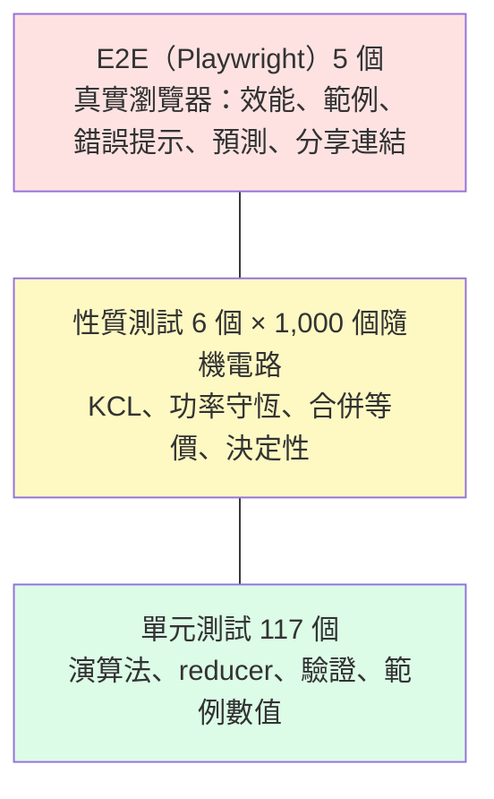
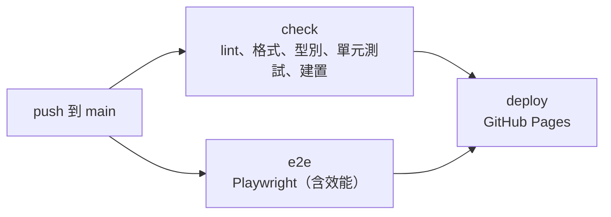

# 第 7 章　測試

> **本章目標**
>
> - 規劃測試策略：哪一層測什麼
> - 實踐 TDD 的紅燈、綠燈、重構
> - 設計性質測試（property-based testing）的產生器與不變量
> - 用「變異檢查」確認測試真的有效
> - 正確地量測前端效能
> - 撰寫驗收測試報告

## 7.1 測試策略



| 層級     | 數量                 | 執行時間       | 測什麼                                | 不測什麼     |
| -------- | -------------------- | -------------- | ------------------------------------- | ------------ |
| 單元測試 | 117                  | < 1 秒（全部） | 純函式的正確性：演算法、reducer、驗證 | 畫面         |
| 性質測試 | 6（共 6,000 個電路） | 約 0.5 秒      | 對**任意**合法電路都成立的物理定律    | 特定數值     |
| E2E      | 5                    | 約 3 秒        | 真實瀏覽器中的整合行為與效能          | 演算法的細節 |

這個比例（大量快速的單元測試、少量慢速的 E2E）稱為**測試金字塔**。它之所以可行，是因為第 3 章的架構把大部分邏輯放在純函式中，**架構決定了測試的成本**。如果求解器寫在 React component 裡，每個測試都要啟動瀏覽器，1,000 個隨機電路的性質測試根本無法執行。

## 7.2 TDD：紅燈、綠燈、重構

本專案的開發流程是：

1. **紅燈**：先寫測試，執行，確認它**失敗**。
2. **綠燈**：寫最少的程式碼讓測試通過。
3. **重構**：測試通過後，才整理程式碼。

### 為什麼一定要先看到紅燈？

一個從來沒有失敗過的測試，你無法確定它真的在測東西。它可能因為 import 錯了而根本沒執行，或者斷言寫錯而永遠成立。**看到紅燈，是確認「這個測試能抓到錯誤」的唯一方法。**

### 實例：錯誤接法的偵測（M3）

先寫好 13 個測試，執行：

```text
× 導線直接接在內電阻為 0 的電池兩端
× 電流計直接並聯在電池兩端
× 兩個電動勢不同、內電阻為 0 的電池直接並聯
× 只接了一端、懸空的元件
× 電壓計串聯在電路中
……
Tests  11 failed | 2 passed (13)
```

11 個紅燈，2 個綠燈。那 2 個為什麼一開始就通過？它們是「電壓計量開路電池不算串聯」和「電壓計量斷開的開關不算串聯」，在偵測功能還不存在時，「不報錯」本來就成立。這種**檢查「不該發生的事沒有發生」的測試**，要等功能完成後才真正有意義。

實作之後：

```text
× 只接了一端、懸空的元件
AssertionError: expected -1.7763568394002506e-16 to be +0
Tests  1 failed | 35 passed (36)
```

剩下的一個紅燈，揭露了浮點殘差的問題（第 8 章故事 2）。修正後全部綠燈。

### 誠實的反省：沒有照順序做的時候

M2（電錶與獨立電路）的 8 個測試寫好之後，執行時**一次全部通過**。原因是這些功能其實在 M1 實作求解器時就已經寫好了，測試是事後補的，從來沒有看過紅燈。

這種情況怎麼辦？答案是**故意弄壞程式碼**，看測試會不會失敗（第 7.5 節）。這不是 TDD，但至少能確認測試有效。

## 7.3 範例測試：用手算值當作標準答案

```ts
/** 驗收標準：與手算值相對誤差小於 0.1%。 */
const MAX_RELATIVE_ERROR = 1e-3;

it('12 V 電池串聯 4 Ω 與 8 Ω：I = 1 A，分壓 4 V 與 8 V', () => {
  const result = solve(
    layoutNetlist([
      { id: 'E', kind: 'battery', n1: 0, n2: 1, emf: 12 },
      { id: 'R4', kind: 'resistor', n1: 1, n2: 2, resistance: 4 },
      { id: 'R8', kind: 'resistor', n1: 2, n2: 0, resistance: 8 },
    ]),
  );
  expect(result.diagnostics).toEqual([]);
  expectClose(resultOf(result, 'E').current, 1);
  expectClose(resultOf(result, 'R4').voltage, 4);
  // ……
});
```

測試的**預期值**從哪裡來？這叫做「測試預言」（test oracle）問題。這裡的答案來自**獨立的手算**，國中課本的方法。重點是預期值**不能**從程式的輸出複製過來，否則測試只會驗證「程式和自己一致」。

不平衡電橋的測試，在註解中寫下了手算過程：

```ts
it('惠斯登電橋（不平衡）：與節點電壓法手算值相符', () => {
  // 手算：7C − 4D = 20，−4C + 7D = 10 ⇒ C = 180/33 V，D = 150/33 V
```

把推導寫進測試，讀者可以自己驗算，也讓測試本身成為一份教材。

### `layoutNetlist`：讓測試好寫，又不失真

如果每個測試都要手寫格點座標，測試會冗長又難讀。`src/solver/testing/layout.ts` 提供了一個工具：用「抽象節點編號」描述電路，自動放到格點上，並用導線把元件接到每個節點的匯流點。

這帶來一個重要的好處：**測試走完整條管線**，包括網表建立和 0 Ω 電流分配，而不是只測 MNA 矩陣。測試越接近真實使用情境，越能抓到整合問題。

## 7.4 性質測試

### 範例測試的盲點

範例測試只能驗證「你想得到的例子」。但學生畫的電路千奇百怪，你不可能一一列舉。

**性質測試**換一個角度：不檢查特定的答案，而是檢查**對任何輸入都必須成立的性質**，再讓電腦產生大量的隨機輸入來驗證。

### 這個領域有哪些「一定成立的性質」？

物理定律就是最好的性質：

| 性質                                   | 物理依據               | 門檻            |
| -------------------------------------- | ---------------------- | --------------- |
| 每個格點流入 = 流出                    | KCL                    | < 1e-9 A        |
| 電源提供的功率 = 元件消耗的功率        | 能量守恆（特勒根定理） | 相對誤差 < 1e-6 |
| 合法電路不會出現 error，數值都是有限值 | 需求 N1                | —               |
| 兩個電路合併求解 = 分開求解            | 互不相連的電路互不影響 | 完全相同        |
| 加上電壓計不改變任何電流               | 理想電壓計內阻無限大   | < 1e-9          |
| 同一電路求解兩次結果相同               | 決定性                 | 位元級相同      |

注意最後三個不是單一輸入的性質，而是**兩個相關輸入之間的關係**：電路 vs. 加了電壓計的電路、合併 vs. 分開、第一次 vs. 第二次。這類測試稱為**蛻變測試**（metamorphic testing），在「不知道正確答案」時特別有用。你不知道一個隨機電路的電流應該是多少，但你知道加上電壓計之後電流**不應該改變**。

### 產生器的設計（`src/solver/testing/randomCircuit.ts`）

性質測試的品質，取決於產生器能不能產生**有代表性**的輸入。

```ts
export const legalNetlistArb: fc.Arbitrary<NetSpec[]> = fc
  .integer({ min: 2, max: 10 }) // 節點數
  .chain((n) =>
    fc.record({
      n: fc.constant(n),
      tree: fc.array(
        fc.tuple(fc.nat(), edgePropsArb), // 生成樹：保證連通
        { minLength: n - 1, maxLength: n - 1 },
      ),
      extra: fc.array(fc.tuple(fc.nat(n - 1), fc.nat(n - 1), edgePropsArb), { maxLength: 8 }), // 額外的邊：形成迴路
    }),
  )
  .map(({ n, tree, extra }) => {
    const specs = [
      ...tree.map(([pick, p], j) => toSpec(j + 1, pick % (j + 1), p)),
      ...extra.map(([n1, n2, p]) => toSpec(n1, n2, p)),
    ];
    return legalize(n, specs);
  });
```

設計重點：

1. **先產生生成樹，保證連通**。第 j + 1 個節點隨機連到前面 j + 1 個節點中的一個，這樣產生的一定是一棵樹。純隨機的邊很容易產生大量互不相連的碎片。
2. **再加額外的邊形成迴路**。只有樹沒有迴路的電路太簡單，測不出並聯、電橋這類結構。
3. **元件種類有權重**：電阻 30%、電池 20%、燈泡 15%……讓常見元件出現得多一些。
4. **數值範圍刻意拉大**：電阻 0.1–1000 Ω（跨 4 個數量級），測試數值穩定性。

### 「合法」要在產生時保證，不能事後過濾

驗收標準要求的是「合法電路」。一個直覺的作法是：隨機產生電路，再丟掉不合法的。但這樣可能丟掉大部分樣本，fast-check 也會抱怨。更好的作法是**在產生時修正**：

```ts
export function legalize(nodeCount: number, specs: readonly NetSpec[]): NetSpec[] {
  const contracted = new UnionFind(nodeCount);
  for (const s of specs) if (isZeroOhm(s)) contracted.union(s.n1, s.n2);
  const idealForest = new UnionFind(nodeCount);
  return specs.map((s) => {
    if (s.kind !== 'battery' || (s.internalR ?? 0) > 0) return s;
    const ra = contracted.find(s.n1);
    const rb = contracted.find(s.n2);
    if (ra !== rb && idealForest.union(ra, rb)) return s;
    return { ...s, internalR: 1 }; // 會形成自環或迴路的理想電池，改成有內電阻
  });
}
```

這段程式碼用的正是第 6.1、6.7 節的同一套 Union-Find 想法：先縮合 0 Ω 元件，再檢查理想電池是否形成自環或迴路。

### 固定種子：讓隨機變得可重現

```ts
const SEED = 20261023;
const RUNS = 1000;
fc.assert(
  fc.property(legalNetlistArb, (specs) => {
    /* ... */
  }),
  { seed: SEED, numRuns: RUNS },
);
```

固定種子後，每次執行產生的 1,000 個電路都一模一樣。CI 上失敗的測試，在本機一定能重現。

### 縮小反例（shrinking）

性質測試失敗時，fast-check 不只告訴你「某個電路失敗了」，還會自動嘗試**縮小**這個電路：刪掉元件、把數值變簡單，找出仍然會失敗的最小電路。開發過程中的一次實際輸出：

```text
× 每個格點流入與流出的電流加總絕對值小於 1e-9 A
Counterexample: [[{"kind":"resistor","n1":1,"n2":0,"resistance":0.1},
                  {"kind":"switch","n1":2,"n2":0,"closed":true}, ……]]
```

數值都被縮小到最簡單的 0.1 Ω、0.5 V。面對一個 9 個元件的電路，比面對隨機產生的 50 個元件、各種奇怪數值的電路好除錯得多。

### 檢查產生器本身

性質測試第一次執行時，6,000 個電路只花了 0.84 秒。**快得可疑。** 會不會產生器產生的都是空電路，或都沒有電流？於是另外寫了一段統計：

```text
n=1000  有電流的電路=582  平均元件數=25.8  最多=51
診斷碼：DANGLING 592、SHORT_CIRCUIT_WARNING 312、VOLTMETER_UNCONNECTED 211、VOLTMETER_IN_SERIES 96
```

58% 的電路有電流流動，平均 26 個元件，會自然觸發各種警告。產生器是有代表性的。

> **重點**：測試通過不代表測試有效。性質測試要**檢查產生器的分布**；所有測試都要**確認它能失敗**。

## 7.5 測試的測試：變異檢查

如何確認測試真的能抓到錯誤？最直接的方法是：**故意在程式中放一個 bug，看測試會不會失敗。**這個技巧稱為**變異測試**（mutation testing）。專業工具（如 Stryker）可以自動產生大量變異；本專案用手動的方式做了兩次。

### 變異一：把導線電流的正負號反過來

```diff
- return edges.map((e) => phi[localOf(e.pa)] - phi[localOf(e.pb)]);
+ return edges.map((e) => phi[localOf(e.pb)] - phi[localOf(e.pa)]);
```

```text
FAIL 電流計讀數等於所在支路的電流
FAIL 兩條並聯導線平分電流，且每個格點都滿足 KCL
FAIL 閉合的開關視同導線
Tests  3 failed | 20 passed
```

M2 那批「從來沒紅過」的測試，確實能抓到這個錯誤。

### 變異二：把導線電流乘上 0.5

```diff
- return edges.map((e) => phi[localOf(e.pa)] - phi[localOf(e.pb)]);
+ return edges.map((e) => 0.5 * (phi[localOf(e.pa)] - phi[localOf(e.pb)]));
```

```text
× 每個格點流入與流出的電流加總絕對值小於 1e-9 A
Counterexample: [...]
```

KCL 性質測試抓到了，並且附上縮小後的反例。

每次變異檢查後都用 `git checkout` 還原，不留下任何修改。

## 7.6 錯誤接法的測試：安全性斷言

需求 N1 的核心是「不當掉、沒有 NaN、有說明」。每個錯誤接法的測試都會呼叫同一個輔助函式：

```ts
/** 每一種錯誤接法都必須：不拋例外、沒有 NaN/Infinity、有一句說明。 */
function expectSafe(result: SolveResult) {
  expect(allFinite(result)).toBe(true);
  for (const d of result.diagnostics) expect(d.message.length).toBeGreaterThan(5);
}
```

再加上針對每種錯誤的具體檢查：錯誤代碼、嚴重程度、標示的元件 id。

把共同的要求抽成輔助函式，有兩個好處：不會漏寫，而且讀測試的人一眼就能看出「這條需求被每個案例檢查過」。

## 7.7 E2E 測試

### 讓 UI 容易被測試

E2E 測試最常見的問題是**脆弱**：改了按鈕文字或 CSS class，測試就壞了。本專案用 `data-*` 屬性作為穩定的測試介面：

```tsx
<g data-element-id={element.id} data-kind={element.kind}>
<g data-brightness={b.toFixed(3)}>
<g data-reading={text}>
```

測試直接讀取這些屬性：

```ts
await expect(page.locator('[data-kind=ammeter] [data-reading]')).toHaveAttribute(
  'data-reading',
  '3.000 A',
);
```

### 最嚴格的 Undo 測試：比對整個畫布

「Undo 後與原本完全相同」要怎麼在畫面上驗證？最嚴格的方法是比對**整個 SVG 的 HTML**：

```ts
const canvasHtml = (page) =>
  page.evaluate(() => document.querySelector('svg.circuit-canvas')?.innerHTML ?? '');

const snapshots = [await canvasHtml(page)];
for (let i = 0; i < 60; i++) {
  // 交錯執行旋轉與修改電阻值
  snapshots.push(await canvasHtml(page));
}
for (let i = 59; i >= 0; i--) {
  await page.keyboard.press('Control+z');
  expect(await canvasHtml(page)).toBe(snapshots[i]); // 一字不差
}
```

元件位置、數值標籤、讀數、燈泡亮度、錯誤標示都在比對範圍內，只要有一個字元不同就會失敗。

## 7.8 效能量測

### 「畫面更新完成」怎麼定義？

需求是「從修改到畫面更新完成 < 100 ms」。要量測，必須先精確定義起點和終點：

- **起點**：派送 Enter 鍵事件的那一刻。
- **終點**：瀏覽器**繪製**了包含新數值的那一幀。

難點在於，JavaScript 沒有「繪製完成」的事件。常見的技巧是：`requestAnimationFrame` 的回呼在**繪製之前**執行，在裡面排一個 `setTimeout(0)`，它會在**繪製之後**執行。

```ts
const start = performance.now();
input.dispatchEvent(new KeyboardEvent('keydown', { key: 'Enter', bubbles: true }));
// 等到下一幀繪製完成：rAF 在繪製前執行，其後的 macrotask 在繪製之後
await new Promise((r) => requestAnimationFrame(() => setTimeout(r, 0)));
const elapsed = performance.now() - start;
```

### 量測的好習慣

| 習慣                | 本專案的作法                                              | 為什麼                                |
| ------------------- | --------------------------------------------------------- | ------------------------------------- |
| 用 production build | Playwright 的 webServer 執行 `vite build && vite preview` | 開發模式有額外的檢查，比較慢          |
| 確認真的有更新      | 量測前後比較標籤文字，沒變化就判定失敗                    | 避免量到「什麼都沒做」的時間          |
| 多次量測取百分位數  | 30 次，回報中位數與 p95                                   | 單次量測會受 GC、排程影響             |
| 量最壞情況          | 200 個元件全部在同一個連通分量                            | 平均情況無法證明需求                  |
| 重複多輪            | 本機 4 輪：p95 為 18.3–19.0 ms                            | 確認結果穩定                          |
| 在 CI 上也跑        | GitHub Actions 上 p95 為 25–38 ms                         | CI 機器比較慢、比較不穩定，但仍要達標 |

## 7.9 驗收測試與測試報告

開發完成後，Node.js 因資安事件升級，需要在新環境重新驗證。驗收測試的流程是：

1. 用 lockfile 重新安裝（`npm ci`），確認環境可以重現。
2. 執行所有自動化測試。
3. **量測實際數值**：測試只斷言「低於門檻」，報告要寫出實際值。例如 KCL 殘差最大 3.98e-13 A，遠低於門檻 1e-9。
4. 針對和畫面有關的驗收標準，寫一次性的驗收腳本，在瀏覽器中逐項驗證，並截圖存證。
5. 逐條對照驗收標準，寫成報告。

驗收腳本第一次執行時，12 項中有 6 項失敗。**每一項都要追查原因，不能直接假設是腳本寫錯**：

- 4 項來自**共用測試工具的潛在缺陷**：等待元件出現的條件寫得太嚴格（第 8 章故事 7）。修正工具後通過。
- 1 項是腳本對 Undo 行為的**錯誤假設**：以為 60 步復原後就不能再復原，但「載入範例」本身也是一步。修正腳本後通過。
- 最後 1 項（流動點方向）修正了腳本的假設後**仍然失敗**。繼續追查，發現是**真正的產品缺陷**：在已開啟的分頁貼上分享連結時，電路不會切換（第 8 章故事 6）。

這說明了驗收測試的價值：它從**使用者的角度**重新檢視系統，常常能發現開發者視角下的盲點。

完整的報告見 [`docs/test-report.md`](../test-report.md)。報告的結構可以作為範本：

1. 結論先行（一張表說完通過與否）
2. 測試步驟（別人可以照著重做）
3. 逐項結果（每項附上測試名稱與實際數值）
4. 發現的問題（現象、原因、影響、處理）
5. 其他觀察（不影響驗收，但值得知道的事）

## 7.10 持續整合（CI）

`.github/workflows/ci.yml` 定義了三個 job：



**只有 check 和 e2e 都通過，才會部署。**有了這道關卡，線上版本一定是通過所有測試的版本。

## 本章重點

1. 測試金字塔可行與否，取決於架構：邏輯放在純函式中，測試才便宜。
2. TDD 的關鍵是「先看到紅燈」；沒紅過的測試要用變異檢查補救。
3. 範例測試的預期值必須來自獨立的推導，不能從程式輸出複製。
4. 性質測試用物理定律當作不變量；蛻變測試在不知道正確答案時特別有用。
5. 產生器要在產生時保證合法，並檢查它的分布。
6. 效能量測要精確定義起點與終點、用 production build、取百分位數。
7. 驗收測試從使用者的角度出發；每個失敗都要追查原因。

## 練習

1. **（蛻變測試）** 寫一個性質測試：把電路中所有電阻值乘以 k（例如 k = 2），所有電流應該變成原來的 1/k。再寫一個：把所有電動勢乘以 k，所有電流應該變成 k 倍。這兩個性質在什麼情況下不成立？（提示：內電阻、警告訊息。）
2. **（變異檢查）** 在 `mna.ts` 中把電阻的蓋章改錯一個符號（例如 `add(i, j, g)`），執行測試，記錄哪些測試失敗了。有沒有哪個變異是所有測試都抓不到的？
3. **（產生器）** 修改 `legalNetlistArb`，讓它也能產生「電動勢相同、內電阻為 0 的並聯電池」（目前的 `legalize` 會把它們改成有內電阻）。需要修改哪些地方？
4. **（E2E）** 為「旋轉元件後按 Undo」寫一個 E2E 測試，用比對 SVG HTML 的方式驗證。
5. **（效能）** 把效能測試中的 `setTimeout(r, 0)` 拿掉，只等 `requestAnimationFrame`，量出來的時間會變長還是變短？為什麼？
6. **（報告）** 以 `docs/test-report.md` 為範本，為你自己的一個專案寫一份一頁的驗收測試報告。
